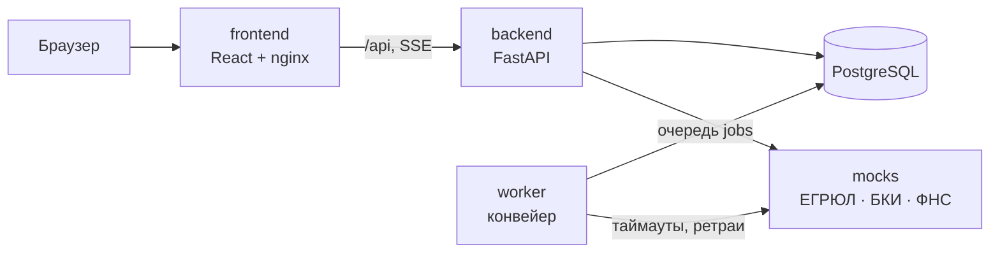

# Поток — умный кредитный кабинет для малого бизнеса

Прототип цифрового кредитного конвейера для Альфа-Хакатона 2026. Предприниматель в веб-кабинете подбирает
кредит под задачу бизнеса, подаёт заявку и в реальном времени видит, что с ней происходит. Банк внутри
проверяет данные, обогащает их из внешних источников, оценивает риск и принимает решение — в одном
связанном процессе.

> **Статус:** шаг 2 из 7 — заявка проходит конвейер целиком: анкета по шагам → проверка → ЕГРЮЛ/ФНС/БКИ →
> оценка → решение, статус обновляется в реальном времени. План — в разделе [«План работ»](#план-работ).

## Быстрый старт

Нужен только Docker (Docker Desktop на Windows/macOS или Docker Engine + Compose v2 на Linux).

```bash
git clone https://github.com/donaldtrumpdev-commits/alpha.git
cd alpha
docker compose up --build
```

| Что | Адрес |
|---|---|
| Кабинет (клиент и аналитик) | http://localhost:8080 |
| API и Swagger | http://localhost:8000/api/docs |
| Эмулятор ЕГРЮЛ/БКИ/ФНС | http://localhost:8001/docs |

Файл `.env` не обязателен: у всех переменных есть безопасные для демо значения (см. `.env.example`).
При первом запуске применяются миграции и загружаются синтетические демо-данные. Вместе с API стартует
воркер конвейера — отправленные заявки он обрабатывает сам.

## Демо-сценарии

На странице входа можно войти в один клик под любой тестовой учётной записью. Пароль у всех — `demo1234`.

| Учётная запись | Кто | Что сделать | Что получится |
|---|---|---|---|
| `bakery@demo.local` | Ольга Северова, директор ООО «Северная пекарня» | «Экспресс-оборот», 3 млн, 12 мес. | Автоматическое одобрение за ~10 секунд |
| `buh@demo.local` | Елена Счётова, главный бухгалтер той же компании | Любая заявка | Может оформить и отправить, подписать договор — нет |
| `sklad@demo.local` | Дмитрий Орлов, директор ООО «ТехноСклад» | «Экспресс-оборот», 10 млн | Контрпредложение: 4,5 млн — лимит по выручке |
| `smirnova@demo.local` | Анна Смирнова, ИП | «Экспресс-оборот», до 1 млн, выписку не прикладывать | Банк запросит выписку; после загрузки — одобрение |
| `vector@demo.local` | Игорь Волков, директор ООО «Вектор Строй» | «Инвестиционный кредит», 25 млн, 48 мес. | Ручное рассмотрение специалистом |
| `start@demo.local` | Павел Быстров, директор ООО «Быстрый старт» | «Экспресс-оборот», 2 млн | Отказ с причинами и подсказками, что улучшить |
| `zakat@demo.local` | Сергей Закатов, ликвидатор ООО «Закат» | Любая заявка | Отказ по стоп-фактору: компания ликвидируется |
| `new@demo.local` | Никита Новиков, новый клиент | Ввести ИНН `0077070071` | Данные подтягиваются из ЕГРЮЛ, затем — обычный путь |
| `analyst@demo.local` | Мария Кредитова, кредитный аналитик | — | Очередь всех отправленных заявок |

Почему исходы именно такие — в [docs/scoring.md](docs/scoring.md).

Все компании и люди вымышлены. ИНН начинаются с «00» — несуществующий код региона, поэтому совпадений с
реальными организациями нет. Эмулятор отвечает и на любой другой корректный ИНН — данные для него
генерируются детерминированно.

## Что работает сейчас

**Клиент**
- Вход в один клик под тестовой учёткой или по почте и паролю.
- Новый клиент вводит ИНН — карточка компании подтягивается из ЕГРЮЛ, ИНН проверяется по контрольной сумме.
- Подбор продукта: цель → сумма и срок → подходящие продукты с платежом, объяснением «почему подходит» и
  оговорками, если параметры выходят за рамки продукта. График платежей по каждому варианту.
- **Анкета по шагам:** компания (из ЕГРЮЛ) → параметры кредита → финансы (выручка и расходы подставляются
  из ФНС, кредитная нагрузка считается на лету) → обеспечение (для инвестиционного кредита) → документы →
  проверка и согласие на запрос в БКИ. Черновик сохраняется на каждом шаге.
- **Живой статус:** после отправки заявка проходит этапы на глазах — проверка данных, запросы в ЕГРЮЛ, ФНС
  и БКИ, оценка, решение. Статус приходит потоком (SSE), без перезагрузки страницы.
- **Решение с объяснением:** одобрение с условиями и причинами; контрпредложение со сравнением «вы просили →
  банк предлагает» и объяснением; отказ с причинами и подсказками, что улучшить.
- **Запросы банка в кабинете:** если данных не хватает, банк просит загрузить документ или указать цифру —
  после ответа заявка сама возвращается в конвейер.

**Банк**
- Очередь отправленных заявок со счётчиками и фильтрами.
- Фоновый конвейер: проверка полноты → обогащение из ЕГРЮЛ/ФНС/БКИ → скоринг по скоркарте → правила решения
  (стоп-факторы, лимит по выручке, долговая нагрузка, контрпредложение).

**Платформа**
- Машина состояний заявки: 14 статусов, права ролей на каждый переход, `409` на недопустимый переход.
- Очередь задач конвейера в БД (transactional outbox), несколько воркеров без конфликтов, восстановление
  «зависших» задач, повтор шага с растущей паузой, передача специалисту при долгом сбое источника.
- Журнал аудита по каждой заявке, идемпотентная отправка, оптимистическая блокировка.
- Эмулятор внешних источников с управляемыми сбоями; клиент интеграций с таймаутами и ретраями.
- Единый формат ошибок, JSON-логи с `X-Request-ID`, healthcheck'и, миграции, 54 автотеста.

## Архитектура



Подробно — [docs/architecture.md](docs/architecture.md). Там же ключевые решения: машина состояний как
единственный источник правды, конвейер на очереди задач, живой статус, отказоустойчивость интеграций,
безопасность.

| Документ | Что внутри |
|---|---|
| [docs/architecture.md](docs/architecture.md) | Компоненты, решения, безопасность, масштабирование |
| [docs/state-machine.md](docs/state-machine.md) | Диаграмма состояний заявки, статусы и переходы (собрана из кода) |
| [docs/scoring.md](docs/scoring.md) | Признаки, скоркарта, правила решения, исходы демо-компаний |
| [docs/data-model.md](docs/data-model.md) | ER-диаграмма и пояснения к модели данных |
| [docs/openapi.json](docs/openapi.json) | Спецификация API (живая версия — `/api/openapi.json`) |
| [THIRD_PARTY_NOTICES.md](THIRD_PARTY_NOTICES.md) | Сторонние компоненты и смоделированные интеграции |

## Структура репозитория

```
backend/          core API: FastAPI, SQLAlchemy, Alembic
  app/domain/     статусы и переходы, продукты и расчёт платежей, проверка ИНН
  app/services/   сценарии заявки, машина состояний, интеграции, запросы банка, документы
  app/pipeline/   конвейер: очередь задач, шаги, воркер (python -m app.worker)
  app/scoring/    признаки, скоркарта, правила кредитного решения
  app/api/        HTTP-эндпоинты, поток статусов (SSE)
  migrations/     миграции схемы БД
  tests/          автотесты (pytest)
mocks/            эмулятор ЕГРЮЛ/ЕГРИП, БКИ и ФНС «Прозрачный бизнес»
frontend/         кабинет клиента и аналитика: React, TypeScript, Mantine
docs/             архитектура, диаграмма состояний, модель данных, OpenAPI
```

## Разработка без Docker

Нужны Python 3.12 и Node.js 20.19+ (или 22 LTS).

```bash
# Эмулятор внешних источников — :8001
cd mocks
python -m venv .venv && .venv/Scripts/pip install -r requirements.txt   # Linux/macOS: .venv/bin/pip
.venv/Scripts/uvicorn mockapi.main:app --port 8001
```

```bash
# Backend — :8000, по умолчанию SQLite-файл local.db
cd backend
python -m venv .venv && .venv/Scripts/pip install -r requirements-dev.txt
.venv/Scripts/alembic upgrade head
.venv/Scripts/uvicorn app.main:app --reload --port 8000
```

```bash
# Воркер конвейера — во втором терминале, из папки backend
.venv/Scripts/python -m app.worker
```

```bash
# Frontend — :5173, запросы /api проксируются на :8000
cd frontend
npm install
npm run dev
```

## Переменные окружения

| Переменная | По умолчанию | Назначение |
|---|---|---|
| `DATABASE_URL` | `sqlite:///./local.db` (в Docker — PostgreSQL) | Строка подключения к БД |
| `SECRET_KEY` | демо-значение | Секрет подписи токенов — обязательно поменять вне локальной машины |
| `MOCKS_URL` | `http://localhost:8001` | Адрес эмулятора внешних источников |
| `INTEGRATION_TIMEOUT_S` | `3.0` | Таймаут запроса к внешнему источнику, с |
| `INTEGRATION_RETRIES` | `3` | Число попыток запроса к внешнему источнику |
| `DEMO_MODE` | `true` | Вход в один клик под тестовыми учётками |
| `SEED_ON_START` | `true` | Загружать демо-данные при старте |
| `TOKEN_TTL_MINUTES` | `720` | Срок жизни токена |
| `LOG_LEVEL` | `INFO` | Уровень логирования |
| `MOCK_LATENCY_MS` | `250` (в Docker — `400`) | Задержка ответа эмулятора, чтобы этапы конвейера были видны |
| `PIPELINE_STEP_DELAY_S` | `1.5` | Пауза между этапами конвейера, чтобы клиент видел, как движется заявка (`0` — без пауз) |
| `PIPELINE_RETRY_BASE_S` | `2.0` | Начальная пауза перед повтором шага при сбое; дальше удваивается |
| `PIPELINE_MAX_ATTEMPTS` | `5` | Сколько раз повторять шаг; после этого — передача специалисту |
| `WORKER_POLL_INTERVAL_S` | `0.5` | Как часто воркер проверяет очередь |
| `OFFER_VALID_DAYS` | `7` | Сколько дней действует предложение банка |
| `UPLOAD_DIR` | `backend/uploads` (в Docker — том `uploads`) | Где хранятся документы клиентов |
| `MAX_UPLOAD_MB` | `10` | Максимальный размер документа |
| `POSTGRES_DB`, `POSTGRES_USER`, `POSTGRES_PASSWORD` | `credit` | Параметры PostgreSQL в docker compose |

## Тесты

```bash
cd backend
.venv/Scripts/python -m pytest
```

Покрыто: правила машины состояний (достижимость всех статусов, права ролей, отзыв заявки), расчёт платежей
и графика, подбор продукта, проверка ИНН, API — вход, права доступа к заявкам, жизненный цикл заявки,
идемпотентная отправка, ошибки валидации, поиск компании и устойчивость к сбою ЕГРЮЛ. Конвейер — все
демо-сценарии от отправки до решения, запрос выписки и продолжение после загрузки, короткий и долгий сбой
БКИ, отзыв заявки посреди конвейера, поток статусов, подстановка финансов из ФНС.

## API

Swagger — http://localhost:8000/api/docs. Ошибки всегда приходят в одном формате:

```json
{ "status": 409, "code": "invalid_transition", "title": "Действие недоступно на этом этапе", "detail": "…" }
```

Живой статус заявки — `GET /api/applications/{id}/stream` (Server-Sent Events, с заголовком
`Authorization`).

Сбой внешнего источника для демонстрации отказоустойчивости: отправьте заявку после команды ниже — бюро
кредитных историй ответит ошибкой дважды, конвейер повторит запрос, и заявка дойдёт до решения. Без `count`
источник «лежит» постоянно, и заявка уходит специалисту с пометкой, какой источник не ответил.

```bash
curl -X POST localhost:8001/admin/faults -H "Content-Type: application/json" -d '{"source":"bki","mode":"error","count":2}'
```

## План работ

- [x] **Шаг 1. Фундамент.** Модель данных, машина состояний, продукты и подбор, эмулятор источников,
  вход, главная клиента, подбор продукта, страница заявки, очередь аналитика, Docker, документация.
- [x] **Шаг 2. Конвейер.** Фоновый воркер: проверка полноты → обогащение из ЕГРЮЛ/БКИ/ФНС → скоринг по
  правилам → решение (стоп-факторы, лимит, контрпредложение, запрос информации). Анкета по шагам с
  автозаполнением, запросы банка в кабинете, живые статусы.
- [ ] **Шаг 3. Подписание и выдача.** Принятие предложения, договор, подписание кодом в кабинете, выдача
  (смоделирована), «Мои кредиты» с графиком платежей.
- [ ] **Шаг 4. Кабинет аналитика.** Карточка заявки с результатами проверок и факторами скоринга, ручное
  решение, журнал аудита, дашборд воронки.
- [ ] **Шаг 5. ML-скоринг.** Модель вероятности дефолта на синтетических данных, объяснения SHAP, отчёт
  валидации (Gini, KS, калибровка, PSI), откат на правила при недоступности.
- [ ] **Шаг 6. ИИ-ассистент.** LLM с открытыми весами: подбор продукта из свободного текста, объяснение
  статуса и решения, сводка для аналитика.
- [ ] **Шаг 7. Сдача.** Коллекция запросов, e2e-тест, тестовые сценарии, деплой на бесплатный сервер.

## Допущения

- Кредитные продукты и ставки — условные, каталог задан в коде (`backend/app/domain/products.py`).
- Внешние источники эмулируются; контракты упрощены с сохранением смысла интеграции.
- Подписание документов и выдача денег будут смоделированы внутри продукта, без реальных операций.
- Весь сценарий проходит в веб-кабинете: без почты, SMS и мессенджеров.
