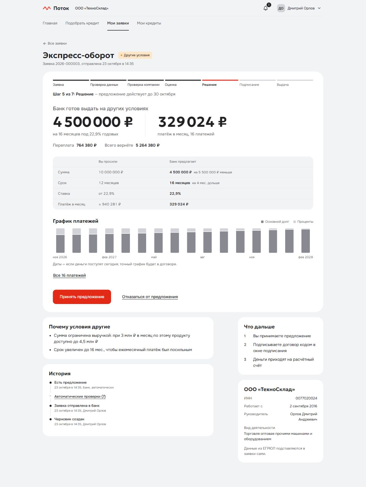
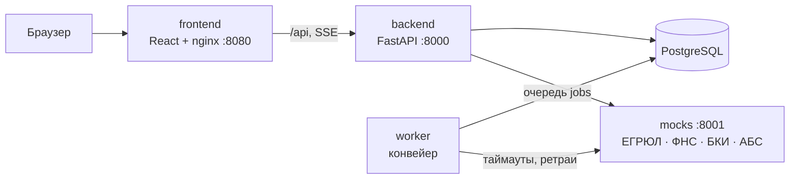

# Поток — умный кредитный кабинет для малого бизнеса

Прототип цифрового кредитного конвейера для Альфа-Хакатона 2026 (кейс «Умный кредитный кабинет
предпринимателя»). Предприниматель в веб-кабинете подбирает кредит под задачу бизнеса, подаёт заявку и в
реальном времени видит, что с ней происходит. Банк проверяет данные, обогащает их из ЕГРЮЛ/ЕГРИП, ФНС
«Прозрачный бизнес» и бюро кредитных историй, оценивает риск, принимает решение — автоматически или руками
кредитного аналитика — и после подписи договора выдаёт кредит. Всё это один связанный процесс в одном
продукте: без почты, SMS и мессенджеров.

**Языковые модели (LLM) в решении не используются.** Скоринг и кредитное решение — объяснимые правила.



Все экраны до и после переделки интерфейса — [docs/interface.md](docs/interface.md).

## Быстрый старт

Нужен только Docker: Docker Desktop на Windows/macOS или Docker Engine с Compose v2 на Linux, x86-64 или
arm64. **Работает на обычном ПК с 8 ГБ памяти без видеокарты** — стенд занимает меньше 0,4 ГБ памяти (замеры —
в разделе «Тесты»). Нужно около 3 ГБ диска, свободные порты 8080, 8000 и 8001 и интернет для первой сборки
образов (дальше стенд работает без интернета).

```bash
git clone https://github.com/donaldtrumpdev-commits/alpha.git
cd alpha
docker compose up --build
```

Первая сборка занимает 3–6 минут. Чтобы команда вернула управление, когда всё готово, запустите
`docker compose up --build -d --wait` — после неё кабинет открыт. Начать с чистыми данными: `docker compose
down -v`, затем снова `up`.

| Что | Адрес | Доступ |
|---|---|---|
| Кабинет клиента и банка | http://localhost:8080 | из сети |
| API и Swagger | http://localhost:8000/api/docs | только с этой машины |
| Эмулятор ЕГРЮЛ/ФНС/БКИ/АБС | http://localhost:8001/docs | только с этой машины |

Файл `.env` не обязателен: у всех переменных есть безопасные для демо значения (см. `.env.example`). При
первом запуске применяются миграции и загружаются синтетические демо-данные; вместе с API стартует воркер
конвейера. Проверить, что стенд работает, можно одной командой (нужен Python 3.10+; в Windows может
называться `py`, в macOS — `python3`):

```bash
python scripts/smoke.py
```

Скрипт подаёт заявку пекарни и ждёт одобрения; заявка остаётся на стенде — у Ольги Северовой на главной и в
симуляторе политики. Чтобы после него пройти «Проверку за 10 минут» с пустого стенда, выполните
`docker compose down -v`, затем `docker compose up --build -d --wait`.

**Вход.** На странице входа нажмите на поле «Почта» — откроется список демо-профилей с компанией и исходом
сценария; выбранный профиль подставляет почту и пароль, остаётся «Войти». Пароль у всех `demo1234`.
У каждой вкладки браузера свой вход, поэтому клиента и аналитика можно открыть рядом и смотреть, как решение
аналитика сразу появляется у клиента. Ссылка на страницу кабинета, открытая в новой вкладке, сначала ведёт на
вход, а после входа — на главную: нужную заявку откройте из списка.

## Проверка за 10 минут

Откройте кабинет в двух вкладках одного браузера: вкладка **А** — клиент, вкладка **Б** — банк. Стенд
стартует без заявок, поэтому очередь аналитика и симулятор политики наполняются по мере шагов 1–4. Пройти
сценарий заново с чистыми данными: `docker compose down -v`, затем `docker compose up --build -d --wait`.

1. **Одобрение и выдача (2,5 мин).** А: войти как Ольга Северова (`bakery@`) → «Подобрать кредит» →
   «Пополнить оборотные средства», 3 000 000 ₽, 12 мес. → «Оформить заявку» у «Экспресс-оборота» → пройти
   анкету (данные компании и выручка подставлены) → согласие на запрос в БКИ → «Отправить в банк». Заявка
   проходит этапы на глазах и через ~10 с одобряется. «Принять предложение» → отметить ознакомление с
   договором → «Подписать кодом» → ввести код из окна подписания → «Деньги на счёте!», кредит и график
   в «Мои кредиты».
   На главной — «Новости для вас» под пекарню; у «ТехноСклада» и «Вектора» лента другая, а когда банк
   запрашивает выписку (шаг 4), наверх поднимается новость о дополнительных документах.
2. **Контрпредложение (1 мин).** А: выйти и войти как Дмитрий Орлов (`sklad@`) → «Экспресс-оборот»,
   10 000 000 ₽, 12 мес. → контрпредложение 4,5 млн на 16 мес. со сравнением «вы просили → банк предлагает».
   Другим продуктом: Лариса Тихонова (`clean@`) → «Экспресс-оборот», 300 000 ₽, 12 мес. → банк предлагает
   «Овердрафт» на 150 тыс.
3. **Ручное решение, видимое клиенту (3 мин).** А: Игорь Волков (`vector@`) → «Купить оборудование или
   транспорт» → «Инвестиционный кредит», 25 000 000 ₽, 48 мес., залог — оборудование, 30 000 000 ₽ →
   отправить → «Рассматривает специалист». Б: войти как Мария Кредитова (`analyst@`) → заявка в очереди
   (фильтр «Ждут решения») → карточка: грейд C, факторы, стоп-факторы, «просит → предлагает», трасса правил →
   «Воспроизвести решение» → «Совпадает». Форма открыта на контрпредложении 19,5 млн на 60 мес.: написать
   обоснование → «Сохранить решение». А: статус меняется сам → принять → появляются условия выдачи →
   подписать кодом → загрузить любой PDF как документ по залогу и ответить на вопрос о поручительстве →
   деньги зачислены.
4. **Отказ и запрос информации (1,5 мин).** А: Павел Быстров (`start@`) → «Экспресс-оборот», 2 000 000 ₽ →
   отказ с причинами и подсказками. Анна Смирнова (`smirnova@`) → 500 000 ₽, 12 мес., выручка 600 000 ₽ →
   банк просит выписку → загрузить PDF → заявку сверяет специалист (Б: «Одобрить» с обоснованием).
5. **Отказоустойчивость (1 мин).** Выполнить команду сбоя БКИ из раздела «Сбой источника» ниже и отправить
   любую заявку пекарни: в истории раскрыть «Автоматические проверки» — там «Бюро кредитных историй: нет ответа —
   повторяем запрос», затем решение.
6. **Политика (1 мин).** Б: «Кредитная политика» (считает заявки, поданные в шагах 1–5) → сдвинуть пороги →
   «Рассчитать»: какие заявки изменили бы
   исход и как сдвинулись доля положительных решений и объём. Заявки при этом не меняются.

Полный список сценариев, негативные и ролевые проверки — [docs/test-scenarios.md](docs/test-scenarios.md).

## Демо-сценарии

Как подать заявку: «Подобрать кредит» → цель, сумма, срок → «Оформить заявку» у продукта → анкета по шагам →
согласие на запрос в БКИ → «Отправить в банк». Данные компании и выручка из ФНС подставляются в анкету сами.

| Учётная запись | Кто | Что ввести | Что получится |
|---|---|---|---|
| `bakery@demo.local` | Ольга Северова, директор ООО «Северная пекарня» | «Пополнить оборотные средства» → «Экспресс-оборот», 3 000 000 ₽, 12 мес.; выручку оставить как подставилась (4,5 млн) | Одобрение 3 млн под 22,9 % за ~10 с → «Принять предложение» → подпись кодом → деньги на счёте, кредит с графиком в «Мои кредиты» |
| `buh@demo.local` | Елена Счётова, главный бухгалтер той же компании | Та же заявка, что у пекарни | Готовит и отправляет заявку; после одобрения — «Передать руководителю на подпись»: Ольга Северова получает уведомление (колокольчик «Уведомления» в шапке кабинета) и подписывает. Принять, отказаться и подписать бухгалтер не может |
| `sklad@demo.local` | Дмитрий Орлов, директор ООО «ТехноСклад» | «Экспресс-оборот», 10 000 000 ₽, 12 мес. | Контрпредложение: 4,5 млн на 16 мес. под 22,9 % — сумма ограничена выручкой, а на 12 мес. прибыль не покрывает платёж с запасом |
| `smirnova@demo.local` | Анна Смирнова, ИП | «Экспресс-оборот», 500 000 ₽, 12 мес.; выручка 600 000 ₽ (в налоговой данных нет); выписку не прикладывать | Банк запросит выписку → загрузить любой PDF → выручка подтверждена только выпиской, поэтому заявку сверяет специалист → аналитик одобряет 500 тыс. под 22,9 % |
| `vector@demo.local` | Игорь Волков, директор ООО «Вектор Строй» | «Купить оборудование или транспорт» → «Инвестиционный кредит», 25 000 000 ₽, 48 мес.; выручка 8 млн (подставится); залог — оборудование, 30 000 000 ₽ | Ручное рассмотрение. Аналитик видит грейд C и рекомендацию 19,5 млн на 60 мес. под 23,5 % (на 48 мес. прибыль покрывает платёж лишь в 0,82 раза) и делает контрпредложение — клиент видит его сразу. После принятия — условия выдачи: документы по залогу и поручительство собственника; договор можно подписать сразу, деньги поступят, когда оба условия закрыты |
| `clean@demo.local` | Лариса Тихонова, директор ООО «Городская химчистка» | «Экспресс-оборот», 300 000 ₽, 12 мес.; выручку оставить как подставилась (1 млн) | Контрпредложение другим продуктом: «Овердрафт», 150 000 ₽ на 12 мес. под 26,9 % — действующие платежи по кредитам съедают почти половину выручки, и «Экспресс-оборот» не проходит даже на минимальную сумму |
| `start@demo.local` | Павел Быстров, директор ООО «Быстрый старт» | «Экспресс-оборот», 2 000 000 ₽, 12 мес. | Отказ с тремя причинами (просрочки, текущая просрочка, убыток) и подсказками, что улучшить |
| `zakat@demo.local` | Сергей Закатов, ликвидатор ООО «Закат» | Любая заявка, например «Экспресс-оборот», 1 000 000 ₽ | Отказ по стоп-фактору: компания ликвидируется |
| `new@demo.local` | Никита Новиков, новый клиент | Ввести ИНН `0077070071` → «Найти» → «Да, это моя компания»; затем «Экспресс-оборот», 2 000 000 ₽, 12 мес. | Карточка ООО «Новые горизонты» подтягивается из ЕГРЮЛ, Никита — руководитель и получает право подписи; заявка одобряется 2 млн под 22,9 % |
| `analyst@demo.local` | Мария Кредитова, кредитный аналитик | Очередь → заявка «Вектора» | Карточка оценки, трасса правил, «Воспроизвести решение» и форма решения; страница «Кредитная политика» — симулятор порогов |

Почему исходы именно такие — в [docs/scoring.md](docs/scoring.md).

**Подписание.** После одобрения — «Принять предложение», отметить ознакомление с договором, «Подписать кодом».
Одноразовый код показывается прямо в окне подписания (электронная подпись смоделирована), SMS и почта по
условиям кейса не используются. Через несколько секунд деньги «зачисляются» через эмулятор АБС, кредит с
графиком платежей появляется в «Мои кредиты».

**Сбой источника.** Чтобы показать отказоустойчивость, «уроните» бюро кредитных историй и отправьте заявку:
с `count` источник ответит ошибкой указанное число раз — при `3` шаг не дозвонится ни с одной из трёх попыток, в
истории заявки в группе «Автоматические проверки» появится «…: нет ответа — повторяем запрос», и через пару секунд
конвейер дойдёт до решения; без `count` источник лежит постоянно, и заявка уходит специалисту с пометкой, какой
источник не ответил.

```bash
curl -X POST localhost:8001/admin/faults -H "Content-Type: application/json" -d '{"source":"bki","mode":"error","count":3}'
```

В Windows PowerShell (там `curl` — другая команда):

```powershell
Invoke-RestMethod -Method Post -Uri http://localhost:8001/admin/faults -ContentType 'application/json' -Body '{"source":"bki","mode":"error","count":3}'
```

### Синтетические данные и профили риска

Все компании и люди вымышлены. ИНН демо-компаний начинаются с «00» — несуществующий код региона, совпадений
с реальными организациями нет. Эмулятор отвечает и на любой другой корректный ИНН с «00»: данные генерируются
детерминированно, а профиль риска задаёт девятая цифра ИНН, поэтому произвольный ИНН даёт разные исходы.
ИНН реальных организаций эмулятор не знает: на такой ИНН кабинет отвечает, что компания не найдена.
Примеры (заявка «Экспресс-оборот», 2 млн, 12 мес.):

| Девятая цифра | Профиль | Пример ИНН | Руководитель по ЕГРЮЛ | Исход |
|---|---|---|---|---|
| 0–4 | благополучная компания | `0078012403` | Павлов Андрей Олегович | одобрение |
| 5 | низкая рентабельность | `0078012450` | Фёдоров Илья Олегович | контрпредложение 450 тыс. на 24 мес. |
| 6 | высокая долговая нагрузка | `0078012467` | Фёдоров Илья Ильич | обычно специалист, иногда контрпредложение |
| 7 | текущая просрочка | `0078012474` | Морозов Сергей Ильич | специалист |
| 8 | налоговый долг, массовый адрес | `0078012481` | Павлов Илья Андреевич | специалист или одобрение с более низким грейдом |
| 9 | компания не действует | `0078012097` / `0078012192` / `0078012298` | Морозов Михаил Викторович / Лебедев Михаил Ильич / Иванов Михаил Андреевич | отказ: ликвидация / специалист: реорганизация / отказ: банкротство |

Подключить компанию может только её руководитель или учредитель по ЕГРЮЛ (в прототипе — сверка по ФИО в
профиле, в банке — по электронной подписи). Поэтому через кабинет эти ИНН пока не подключить: единственный
демо-клиент без компании, `new@`, — руководитель «Новых горизонтов». Профили проверяются автотестами
(`backend/tests/test_profiles.py`) и через API.

## Что реализовано

**Сквозной путь клиента (P0)**
- Вход, привязка компании по ИНН с проверкой полномочий по ЕГРЮЛ, подбор продукта под цель с платежом и
  графиком, анкета по шагам с автозаполнением из ЕГРЮЛ и ФНС, черновик сохраняется на каждом шаге.
- Живой статус: заявка проходит этапы на глазах (поток Server-Sent Events, без перезагрузки страницы).
- Решение с объяснением: одобрение, контрпредложение со сравнением «вы просили → банк предлагает», запрос
  информации в кабинете, отказ с причинами и подсказками.
- Принятие предложения, кредитный договор с графиком, подпись одноразовым кодом в окне подписания (код
  хранится только как HMAC и привязан к хешу условий договора), выдача через эмулятор АБС с
  идемпотентностью по номеру договора, «Мои кредиты» с остатком и датами платежей.

**Кабинет банка (P0)**
- Очередь заявок, обновляется сама.
- Карточка аналитика: почему заявка у специалиста, балл, грейд, вероятность дефолта, вклад факторов,
  стоп-факторы чек-листом, заявленная и подтверждённая выручка, «клиент просит → конвейер предлагает» с
  нагрузкой и покрытием.
- Решение аналитика: одобрить, контрпредложение, запросить информацию, отказать, повторить проверки после
  сбоя источника. Обоснование обязательно и видно только банку; аналитик связан той же политикой, что и
  конвейер; сумма выше полномочий — кредитный комитет; отклонение от рекомендации пишется в журнал.

**Кредитная политика 1.1**
- Скоринг (балльная карта, грейды A–E) отделён от решения. Решение: стоп-факторы → подтверждение выручки →
  грейд → поводы для специалиста → лимит по выручке → нагрузка ≤ 50 % выручки и покрытие нового платежа
  прибылью ≥ 1,2 → подбор самого короткого подходящего срока → контрпредложение другим продуктом, если
  запрошенный не проходит.
- Поводы для специалиста: текущая просрочка, выручка только по выписке, нет данных о расходах, реорганизация,
  продукт с ручным решением, грейд C/D. Предложения и неотвеченные запросы банка истекают сами.

**Отличия процесса**
- **Бухгалтер готовит — директор подписывает.** Сотрудник без права подписи передаёт предложение
  руководителю; тот получает уведомление, а право подписи сверяется с руководителем по ЕГРЮЛ.
- **Профили риска в эмуляторе** по девятой цифре ИНН и точные причины отказа по статусу компании.
- **Новости для вас.** Синтетические новости на главной, подобранные под отрасль по ОКВЭД, правовую форму,
  продукты заявок и текущий статус последней заявки; у каждой — почему она показана. Учитывается и регион
  (по первым цифрам ИНН), но у демо-компаний код региона условный «00», поэтому на демо это правило не
  срабатывает. Источник смоделирован.
- **Трасса и воспроизведение решения.** Аналитик видит правила по порядку с результатом каждого и может
  воспроизвести решение на сохранённых признаках — результат должен совпасть.
- **Симулятор политики.** Риск-менеджер меняет пороги нагрузки и покрытия и видит, у каких заявок изменился
  бы исход и как сдвинулись бы доля положительных решений и объём. Заявки не меняются.
- **Условия выдачи по продукту.** Для кредита с залогом деньги уходят после документов по залогу и
  поручительства собственника.

**Интерфейс**
- Один визуальный язык на всех экранах клиента и банка: шрифты Onest и Geologica, графитовая гамма, один
  красный акцент для главного действия, одинаковый выбор в списках вариантов. Суммы и сроки не разрываются
  переносом строки.
- Телефон: нижняя навигация, главное действие закреплено над ней, на ширине 390 px нет горизонтальной
  прокрутки ни на одном экране (`e2e/tests/layout.spec.ts`).
- На каждом экране есть загрузка, ошибка сервера с повтором, пустое состояние и страница «не найдено».
  Профиль показывает роль, право подписи и компанию из `/api/auth/me`.
- До и после — [docs/interface.md](docs/interface.md).

**Платформа**
- Машина состояний заявки — единственный источник правды: 14 статусов, права ролей на каждый переход, `409`
  на недопустимый переход, журнал аудита по каждому действию.
- Очередь задач конвейера в БД (transactional outbox, `FOR UPDATE SKIP LOCKED`), несколько воркеров без
  конфликтов, повтор шага с растущей паузой, передача специалисту, если шаг или источник так и не отработал.
- Идемпотентная отправка, оптимистическая блокировка, единый формат ошибок, JSON-логи с `X-Request-ID`,
  healthcheck'и всех сервисов, включая «пульс» воркера.
- 144 автотеста; CI в GitHub Actions: тесты на PostgreSQL по схеме из миграций, сборка фронтенда, сверка
  OpenAPI, диаграммы состояний и коллекции запросов с кодом, `docker compose up` с нуля, дымовой сценарий,
  коллекция запросов через newman и сценарии всех демо-учёток в браузере (Playwright).

## Что ещё не готово

- Подключение произвольного ИНН через кабинет (см. выше), аналитик пока не может предложить другой продукт,
  срока на закрытие условий выдачи нет.
- Публичный стенд не развёрнут.

## Документация

| Документ | Что внутри |
|---|---|
| [docs/SUBMISSION.md](docs/SUBMISSION.md) | Всё для запуска и проверки в одном документе: версия, запуск, демо-учётки, основной сценарий, ссылки на документы, ограничения; то же в PDF — [docs/SUBMISSION.pdf](docs/SUBMISSION.pdf) |
| [docs/product.md](docs/product.md) | Пользователи и их боли, модель кредитного процесса и его границы, почему такой MVP |
| [docs/architecture.md](docs/architecture.md) | Компоненты, ключевые решения, безопасность, масштабирование |
| [docs/state-machine.md](docs/state-machine.md) | Диаграмма состояний заявки, статусы и переходы (собрана из кода) |
| [docs/data-model.md](docs/data-model.md) | ER-диаграмма и пояснения к модели данных |
| [docs/scoring.md](docs/scoring.md) | Признаки, скоркарта, правила решения, исходы демо-компаний |
| [docs/api.md](docs/api.md) | Описание API: роли, ошибки, идемпотентность, поток статусов, примеры |
| [docs/openapi.json](docs/openapi.json) | Спецификация API (живая версия — http://localhost:8000/api/docs) |
| [docs/postman_collection.json](docs/postman_collection.json) | Коллекция запросов: сквозной сценарий от входа до выданного кредита и все эндпоинты |
| [docs/test-scenarios.md](docs/test-scenarios.md) | Тестовые сценарии: сквозные, отказоустойчивость, негативные и ролевые |
| [docs/interface.md](docs/interface.md) | Интерфейс до и после переделки: снимки экранов на 1440 px и на телефоне |
| [docs/product/product-analytics.md](docs/product/product-analytics.md) | Рынок, конкуренты, пользователи, интервью, что добавить, метрики, питч |
| [docs/product/knowledge-base.md](docs/product/knowledge-base.md) | Принципы текстов, база знаний для подсказок и ИИ-ассистента, глоссарий |
| [THIRD_PARTY_NOTICES.md](THIRD_PARTY_NOTICES.md) | Сторонние компоненты, данные и смоделированные интеграции |
| [RELEASE.md](RELEASE.md) | Версия на проверку, как её проверить, список артефактов сдачи |
| [CHANGELOG.md](CHANGELOG.md) | История изменений |

## Архитектура



## Структура репозитория

```
backend/          API: FastAPI, SQLAlchemy, Alembic
  app/domain/     статусы и переходы, продукты и платежи, ИНН, полномочия по ЕГРЮЛ
  app/scoring/    признаки, скоркарта, правила решения, трасса
  app/pipeline/   конвейер: очередь задач, шаги и их повторы
  app/worker.py   фоновый воркер конвейера (python -m app.worker)
  app/services/   заявки, решение аналитика, подписание, кредиты, лента, симулятор политики
  app/api/        HTTP-эндпоинты, поток статусов (SSE)
  app/data/       синтетические новости для ленты
  migrations/     миграции схемы БД
  scripts/        выгрузка OpenAPI, диаграммы состояний и коллекции запросов
  tests/          автотесты (pytest)
mocks/            эмулятор ЕГРЮЛ/ЕГРИП, ФНС «Прозрачный бизнес», БКИ и АБС банка
frontend/         кабинеты клиента и банка: React, TypeScript, Mantine
e2e/              сквозные проверки поднятого стенда: коллекция запросов (newman), сценарии в браузере (Playwright),
                  запись основного сценария на видео
scripts/          дымовая проверка стенда (smoke.py) и отчёт о ресурсах после прогона в CI (resource_report.py)
docs/             архитектура, диаграмма состояний, модель данных, OpenAPI, коллекция запросов, тестовые сценарии
  product/        продуктовая аналитика и база знаний
  screenshots/    снимки интерфейса до и после переделки
```

## Разработка без Docker

Нужны Python 3.12 и Node.js 22 LTS. В Linux и macOS вместо `.venv/Scripts` — `.venv/bin`.

```bash
# Эмулятор внешних источников — :8001
cd mocks
python -m venv .venv && .venv/Scripts/pip install -r requirements.txt
.venv/Scripts/uvicorn mockapi.main:app --port 8001
```

```bash
# Backend — :8000, по умолчанию SQLite-файл local.db
cd backend
python -m venv .venv && .venv/Scripts/pip install -r requirements-dev.txt
.venv/Scripts/alembic upgrade head
.venv/Scripts/uvicorn app.main:app --reload --port 8000
```

```bash
# Воркер конвейера — во втором терминале, из папки backend
.venv/Scripts/python -m app.worker
```

```bash
# Frontend — :5173, запросы /api проксируются на :8000
cd frontend
npm ci
npm run dev
```

## Переменные окружения

| Переменная | По умолчанию | Назначение |
|---|---|---|
| `DATABASE_URL` | SQLite-файл `backend/local.db` (в Docker — PostgreSQL) | Строка подключения к БД |
| `SECRET_KEY` | демо-значение | Секрет подписи токенов и кодов — обязательно поменять вне локальной машины |
| `MOCKS_URL` | `http://localhost:8001` | Адрес эмулятора внешних источников |
| `INTEGRATION_TIMEOUT_S` | `3.0` | Таймаут запроса к внешнему источнику, с |
| `INTEGRATION_RETRIES` | `3` | Число попыток запроса к внешнему источнику |
| `DEMO_MODE` | `true` | Список демо-профилей на странице входа и вход без пароля |
| `SEED_ON_START` | `true` | Загружать демо-данные при старте |
| `TOKEN_TTL_MINUTES` | `720` | Срок жизни токена |
| `LOG_LEVEL` | `INFO` | Уровень логирования |
| `MOCK_LATENCY_MS` | `250` (в Docker — `400`) | Задержка ответа эмулятора, чтобы этапы конвейера были видны |
| `PIPELINE_STEP_DELAY_S` | `1.5` | Пауза между этапами конвейера (`0` — без пауз) |
| `PIPELINE_RETRY_BASE_S` | `2.0` | Начальная пауза перед повтором шага при сбое; дальше удваивается |
| `PIPELINE_MAX_ATTEMPTS` | `5` | Сколько раз повторять шаг; после этого — передача специалисту |
| `WORKER_POLL_INTERVAL_S` | `0.5` | Как часто воркер проверяет очередь |
| `WORKER_HEARTBEAT_FILE` | не задан (в Docker — `/tmp/worker-heartbeat`) | Файл «пульса» воркера для healthcheck |
| `HOUSEKEEPING_INTERVAL_S` | `60` | Как часто воркер закрывает просроченные предложения и запросы |
| `OFFER_VALID_DAYS` | `7` | Сколько дней действует предложение банка |
| `NEEDS_INFO_TTL_DAYS` | `14` | Сколько дней банк ждёт ответа на свой запрос |
| `ANALYST_AUTHORITY_LIMIT` | `30000000` | Сумма, которую аналитик одобряет сам; выше — кредитный комитет |
| `SIGNING_CODE_TTL_S` | `300` | Сколько действует код подписи |
| `SIGNING_MAX_ATTEMPTS` | `3` | Сколько раз можно ошибиться в коде |
| `SIGNING_CODES_PER_HOUR` | `5` | Сколько кодов подписи можно запросить по заявке за час |
| `DISBURSE_RETRY_S` | `60` | Пауза перед новой попыткой выдачи, если АБС долго не отвечает |
| `BANK_NAME` | `АО «Банк» (демо)` | Название кредитора в договоре |
| `UPLOAD_DIR` | `backend/uploads` (в Docker — том `uploads`) | Где хранятся документы клиентов |
| `MAX_UPLOAD_MB` | `10` | Максимальный размер документа |
| `POSTGRES_DB`, `POSTGRES_USER`, `POSTGRES_PASSWORD` | `credit` | Параметры PostgreSQL в docker compose |
| `ENVIRONMENT` | `local` (в Docker — `demo`) | Имя окружения; вне `local`/`test` демо-значение `SECRET_KEY` даёт предупреждение в логе при старте |
| `MOCK_TIMEOUT_SLEEP_S` | `10` | Эмулятор: сколько «висит» источник в режиме сбоя `timeout` |

В Docker из `.env` передаются: `POSTGRES_*` — в db, backend и worker; `SECRET_KEY` — в backend и worker;
`DEMO_MODE`, `SEED_ON_START` и `ENVIRONMENT` — в backend; `PIPELINE_STEP_DELAY_S` — в worker; `MOCK_LATENCY_MS` —
в mocks. Остальные переменные задаются в `docker-compose.yml` (секция `environment` нужного сервиса) или
используются при запуске без Docker.

## Тесты

Нужно окружение `backend/.venv` из раздела «Разработка без Docker» (в Linux и macOS — `.venv/bin/python`):

```bash
cd backend
.venv/Scripts/python -m pytest
```

По умолчанию тесты идут на временном SQLite; с переменной `TEST_DATABASE_URL` — на PostgreSQL (так делает
CI). Покрыты машина состояний и права ролей, все демо-сценарии от отправки до решения, запросы банка,
сбои источников и АБС, подписание и выдача, решение аналитика и его ограничения, правила политики на
компаниях с заданным профилем риска, трасса и воспроизведение решения, симулятор, лента новостей,
идемпотентность, токены и привязка компании.

Сквозные проверки поднятого стенда (Node.js 22; CI запускает их на `docker compose` с нуля):

```bash
cd e2e
npm ci
npx playwright install chromium
npm run api     # коллекция запросов через newman: от входа до выданного кредита
npm run ui      # демо-сценарии из таблицы выше в браузере, включая аналитика, ленту, сбой БКИ и ширину на телефоне
npm run demo    # основной сценарий в человеческом темпе с подписями, запись на видео (demo-results/…/video.webm)
```

Сценарии в браузере меняют данные стенда (`new@` подключает компанию один раз), поэтому запускайте их на
чистом стенде: `docker compose down -v`, затем `docker compose up --build -d --wait`.

Ресурсы стенда CI измеряет сам: после `docker compose up --wait` запускается фоновый замер — примерно раз в 2–4
секунды в файл пишется `docker stats` (сам `docker stats --no-stream` отрабатывает за 1–2 секунды). После полного
прогона сценариев собирается отчёт — пик памяти каждого контейнера и их сумма, размеры образов, диск Docker.
Таблица выводится в сводке задания «Clean start from README, smoke, request collection and browser scenarios» на
странице прогона (Actions → прогон → Summary) и лежит в артефакте `resources` (`resources.md` и сырые замеры
`stats.log`). Отчёт строит `scripts/resource_report.py`, формат
замеров описан в начале файла.

Замер на раннере CI: 2 vCPU, 7,9 ГБ памяти, без видеокарты. На этой же машине шли сборка образов, стенд и все
сценарии — коллекция запросов, 12 сценариев в браузере и запись видео.

| Что | Результат |
|---|---|
| Память всех контейнеров в один момент, максимум | 235 МиБ |
| Сумма пиков контейнеров — оценка сверху, с кэшем файлов | 322 МиБ: db 101, backend 89, worker 74, mocks 48, frontend 11 |
| Образы стенда | backend и worker — один образ, 205 МБ; postgres 276 МБ; mocks 142 МБ; frontend 49 МБ |
| Диск Docker после сборки | образы вместе с промежуточными слоями сборки — 2,4 ГБ, кэш сборки — 0,15 ГБ, данные — 0,05 ГБ |

На Windows и macOS к этому добавляется виртуальная машина Docker Desktop, обычно 1–2 ГБ. На ПК с 8 ГБ памяти
остаётся запас, поэтому ограничения памяти контейнерам не заданы.

Проверка по этому README на ноутбуке: Windows 11, Docker Desktop на WSL 2 с лимитом памяти 6 ГБ, Docker без образов и
кэша. `docker compose up --build` до готовности всех сервисов — 4 мин 9 с. Пик памяти контейнеров — 346 МиБ по сумме
пиков и 268 МиБ в один момент; вся виртуальная машина Docker занимала до 1,9 ГБ во время сборки и до 1,4 ГБ во время
сценариев. Docker Desktop хранит образы в containerd, и `docker images` показывает размеры больше, чем на раннере:
backend и worker 301 МБ (слои общие), postgres 395 МБ, mocks 213 МБ, frontend 76 МБ; `docker system df` — 0,8 ГБ
образов и 0,9 ГБ кэша сборки.

Основной сценарий CI записывает на видео после всех проверок, на отдельном чистом стенде (`docker compose down -v`,
затем `up -d --wait` без пересборки): клиент «Северной пекарни» от подбора кредита до выдачи и графика платежей,
затем кабинет аналитика — очередь, оценка и трасса правил, воспроизведение решения, симулятор политики. Запись
лежит в артефакте `demo-video` на странице прогона (Actions → прогон → Artifacts), хранится 30 дней: mp4, если на
раннере есть ffmpeg, иначе webm. Это отдельный конфиг (`e2e/playwright.demo.config.ts`), в `npm run ui` он не входит.

## API

Swagger — http://localhost:8000/api/docs. Ошибки всегда приходят в одном формате:

```json
{ "status": 409, "code": "invalid_transition", "title": "Действие недоступно на этом этапе", "detail": "…" }
```

Живой статус заявки — `GET /api/applications/{id}/stream` (Server-Sent Events с заголовком `Authorization`).

## Допущения

- Кредитные продукты, ставки и пороги политики условные; каталог задан в коде
  (`backend/app/domain/products.py`), правила — в `backend/app/scoring/`.
- Внешние источники (ЕГРЮЛ/ЕГРИП, ФНС, БКИ, АБС) эмулируются; контракты упрощены с сохранением смысла.
- Покрытие прибылью считается для нового платежа — упрощённый показатель, а не полный DSCR (см.
  [docs/scoring.md](docs/scoring.md)).
- Выписка по счёту не разбирается: выручка из анкеты принимается при приложенной выписке, но такую заявку
  всегда сверяет специалист. Загруженные файлы банк видит списком (имя и размер), просмотр файла в кабинете
  аналитика не сделан.
- Аналитик видит в карточке производные факторы из ЕГРЮЛ, ФНС и БКИ; сами ответы источников — в API
  `GET /api/applications/{id}/checks` (Swagger, роль аналитика).
- Подписание — простая электронная подпись, смоделирована: код показывается в окне подписания; в банке —
  подтверждение в мобильном банке или УКЭП руководителя. Личность заявителя сверяется по ФИО, в банке — по
  электронной подписи.
- Овердрафт оформляется как кредит с уплатой процентов ежемесячно и возвратом долга в конце срока; в банке —
  лимит на счёте с траншами. Посильность для него считается по аннуитетному эквиваленту.
- Лента новостей — синтетические новости, внешних источников нет.
- Весь сценарий проходит в веб-кабинете: без почты, SMS и мессенджеров. LLM не используются.

## Развитие

- ML-скоринг на реальных данных с тем же интерфейсом оценки и объяснениями, валидация (Gini, KS, PSI).
- Полный DSCR по отчётности, разбор выписки в формате 1С (ClientBankExchange), лимиты по залогу (LTV).
- Второе согласование и кредитный комитет, «взять заявку в работу», контрпредложение другим продуктом
  от аналитика.
- Мониторинг после выдачи, продление лимитов, реальные интеграции и электронная подпись.
