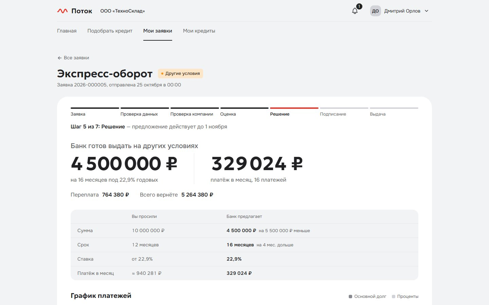
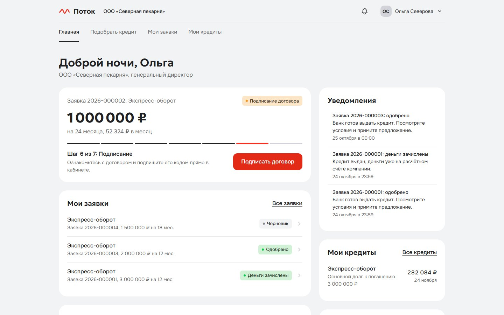
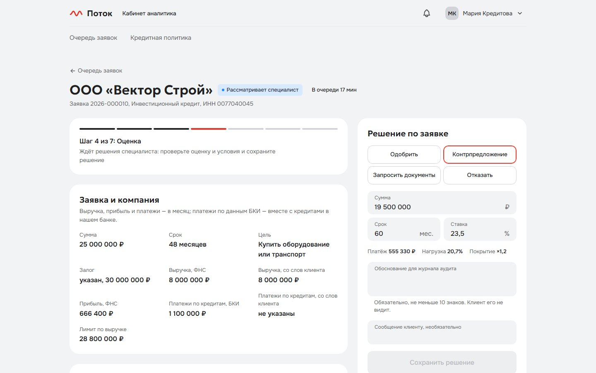
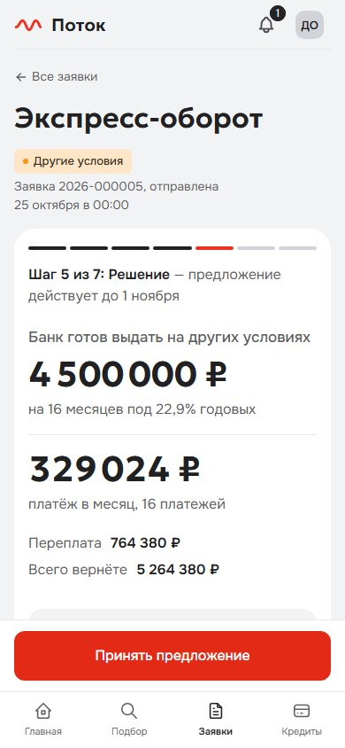
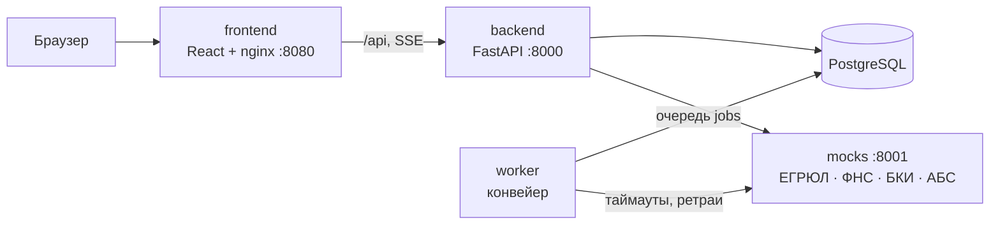

# Поток — кредитный кабинет для малого бизнеса

Прототип для Альфа-Хакатона 2026, кейс «Умный кредитный кабинет предпринимателя». Предприниматель подбирает
кредит под задачу бизнеса, подаёт заявку и видит, что с ней происходит. Банк проверяет компанию по ЕГРЮЛ, ФНС и
бюро кредитных историй, решает сам или руками аналитика и после подписи договора выдаёт деньги. Весь путь проходит
в одном кабинете, без почты и SMS.

Решение по заявке принимают правила кредитной политики. К нему можно добавить пояснение простыми словами от
локальной модели с открытыми весами; по умолчанию это выключено (`LLM_ENABLED=false`), подробнее в
[docs/llm.md](docs/llm.md).



| Главная клиента | Карточка аналитика | Решение на телефоне |
|---|---|---|
|  |  |  |

## Запуск

Нужен Docker: Docker Desktop на Windows и macOS или Docker Engine с Compose v2 на Linux. Хватит обычного ПК с 8 ГБ
памяти, видеокарта не нужна. Порты 8080, 8000 и 8001 должны быть свободны, интернет нужен только для первой сборки.

```bash
git clone https://github.com/donaldtrumpdev-commits/alpha.git
cd alpha
docker compose up --build
```

Первая сборка занимает несколько минут. Если нужно, чтобы команда вернула управление, когда всё готово:
`docker compose up --build -d --wait`. Начать с чистыми данными: `docker compose down -v`, затем снова `up`.

| Что | Адрес |
|---|---|
| Кабинет клиента и банка | http://localhost:8080 |
| API и Swagger | http://localhost:8000/api/docs |
| Эмулятор ЕГРЮЛ, ФНС, БКИ и АБС | http://localhost:8001/docs |

По умолчанию все три адреса открываются только с этой машины. Чтобы зайти в кабинет с другого устройства в сети,
добавьте в `.env` строку `FRONTEND_BIND=0.0.0.0`. Сам `.env` не обязателен, умолчания подходят для демо (см.
`.env.example`).

Проверить, что стенд работает (Python 3.10+, в Windows он может называться `py`, в macOS `python3`):

```bash
python scripts/smoke.py
```

Скрипт входит под пекарней, подаёт заявку и ждёт одобрения. Эта заявка остаётся на стенде, поэтому перед проверкой
по шагам ниже лучше начать с чистых данных.

Вход: на странице входа нажмите на поле «Почта», откроется список демо-профилей с компанией и исходом сценария.
Пароль у всех `demo1234`. У каждой вкладки браузера свой вход, так что клиента и аналитика можно открыть рядом.

## Проверка за 10 минут

Откройте кабинет в двух вкладках: А для клиента, Б для банка. Стенд стартует без заявок, очередь аналитика и
симулятор политики наполняются по ходу шагов.

1. Одобрение и выдача. А: Ольга Северова (`bakery@`) → «Подобрать кредит» → «Пополнить оборотные средства»,
   3 000 000 ₽, 12 мес. → «Оформить заявку» у «Экспресс-оборота» → анкета (данные компании и выручка уже
   подставлены) → согласие на запрос в БКИ → «Отправить в банк». Заявка проходит этапы на глазах и примерно через
   10 секунд одобряется. «Принять предложение» → отметить ознакомление с договором → «Подписать кодом» → ввести код
   из окна подписания → «Деньги на счёте!», кредит с графиком в «Мои кредиты». На главной лента «Новости для вас»
   подобрана под пекарню, у других компаний она своя.
2. Другие условия. А: Дмитрий Орлов (`sklad@`) → «Экспресс-оборот», 10 000 000 ₽, 12 мес. → банк предлагает
   4,5 млн на 16 мес. и показывает сравнение «вы просили → банк предлагает». Лариса Тихонова (`clean@`) →
   «Экспресс-оборот», 300 000 ₽, 12 мес. → банк предлагает другой продукт, «Овердрафт» на 150 тыс.
3. Решение аналитика. А: Игорь Волков (`vector@`) → «Купить оборудование или транспорт» → «Инвестиционный
   кредит», 25 000 000 ₽, 48 мес., залог — оборудование на 30 000 000 ₽ → отправить → «Рассматривает специалист».
   Б: Мария Кредитова (`analyst@`) → заявка в очереди (фильтр «Ждут решения») → карточка: грейд C, факторы,
   стоп-факторы, «просит → предлагает», трасса правил → «Воспроизвести решение» → «Совпадает». Форма уже заполнена
   рекомендацией 19,5 млн на 60 мес.: написать обоснование → «Сохранить решение». А: статус меняется сам → принять
   → появляются условия выдачи → подписать кодом → загрузить документ по залогу (подойдёт
   [docs/samples/collateral.pdf](docs/samples/collateral.pdf)) и ответить на вопрос о поручительстве → деньги
   зачислены.
4. Отказ и запрос документов. А: Павел Быстров (`start@`) → «Экспресс-оборот», 2 000 000 ₽ → отказ с причинами
   и подсказками. Анна Смирнова (`smirnova@`) → 500 000 ₽, 12 мес., выручка 600 000 ₽ → банк просит выписку →
   загрузить [docs/samples/bank-statement.pdf](docs/samples/bank-statement.pdf) → заявку сверяет специалист
   (Б: «Одобрить» с обоснованием). Пока банк ждёт выписку, наверху ленты новость о дополнительных документах.
5. Сбой источника. Выполните команду из раздела ниже и отправьте любую заявку пекарни. В истории заявки раскройте
   свёрнутую группу «Автоматические проверки»: там строка «Бюро кредитных историй: нет ответа — повторяем
   запрос», а за ней решение.
6. Политика. Б: «Кредитная политика» → сдвинуть пороги → «Рассчитать». Видно, у каких заявок из шагов 1–5
   изменился бы исход и как сдвинулись доля одобрений и объём. Сами заявки не меняются.

Все сценарии, включая негативные и ролевые, описаны в [docs/test-scenarios.md](docs/test-scenarios.md).

### Сбой источника

Команда «роняет» бюро кредитных историй на три ответа подряд: конвейер повторит запрос и дойдёт до решения. Без
`count` источник лежит, пока сбой не снят, и заявка уходит специалисту с пометкой, какой источник не ответил.

```bash
curl -X POST localhost:8001/admin/faults -H "Content-Type: application/json" -d '{"source":"bki","mode":"error","count":3}'
```

В Windows PowerShell:

```powershell
Invoke-RestMethod -Method Post -Uri http://localhost:8001/admin/faults -ContentType 'application/json' -Body '{"source":"bki","mode":"error","count":3}'
```

## Демо-сценарии

Заявка подаётся так: «Подобрать кредит» → цель, сумма, срок → «Оформить заявку» у продукта → анкета по шагам →
согласие на запрос в БКИ → «Отправить в банк». Данные компании и выручка из ФНС подставляются сами.

| Учётная запись | Кто | Что ввести | Что получится |
|---|---|---|---|
| `bakery@demo.local` | Ольга Северова, директор ООО «Северная пекарня» | «Экспресс-оборот», 3 000 000 ₽, 12 мес.; выручку оставить как подставилась (4,5 млн) | Одобрение 3 млн под 22,9 % примерно за 10 секунд → принять → подписать кодом → деньги на счёте, кредит с графиком |
| `buh@demo.local` | Елена Счётова, главный бухгалтер той же компании | Та же заявка | Готовит и отправляет заявку, после одобрения передаёт её руководителю на подпись. Ольга Северова получает уведомление в кабинете и подписывает. Принять, отказаться и подписать бухгалтер не может |
| `sklad@demo.local` | Дмитрий Орлов, директор ООО «ТехноСклад» | «Экспресс-оборот», 10 000 000 ₽, 12 мес. | Другие условия: 4,5 млн на 16 мес. под 22,9 %. Сумму ограничивает выручка, а на 12 мес. прибыль не покрывает платёж с запасом |
| `smirnova@demo.local` | Анна Смирнова, ИП | «Экспресс-оборот», 500 000 ₽, 12 мес.; выручка 600 000 ₽ (в налоговой данных нет); выписку не прикладывать | Банк просит выписку → загрузить PDF → выручку подтверждает только выписка, поэтому заявку сверяет специалист → аналитик одобряет 500 тыс. под 22,9 % |
| `vector@demo.local` | Игорь Волков, директор ООО «Вектор Строй» | «Инвестиционный кредит», 25 000 000 ₽, 48 мес.; выручка 8 млн (подставится); залог — оборудование, 30 000 000 ₽ | Решает специалист. Аналитик видит грейд C и рекомендацию 19,5 млн на 60 мес. под 23,5 % (на 48 мес. прибыль покрывает платёж только в 0,82 раза) и делает контрпредложение. После принятия — условия выдачи: документы по залогу и поручительство собственника. Подписать договор можно сразу, деньги придут, когда оба условия закрыты |
| `clean@demo.local` | Лариса Тихонова, директор ООО «Городская химчистка» | «Экспресс-оборот», 300 000 ₽, 12 мес.; выручку оставить как подставилась (1 млн) | Другой продукт: «Овердрафт», 150 000 ₽ на 12 мес. под 26,9 %. Действующие платежи по кредитам съедают почти половину выручки, и «Экспресс-оборот» не проходит даже на минимальную сумму |
| `start@demo.local` | Павел Быстров, директор ООО «Быстрый старт» | «Экспресс-оборот», 2 000 000 ₽, 12 мес. | Отказ с тремя причинами (просрочки, текущая просрочка, убыток) и подсказками, что улучшить |
| `zakat@demo.local` | Сергей Закатов, ликвидатор ООО «Закат» | Любая заявка, например «Экспресс-оборот», 1 000 000 ₽ | Отказ по стоп-фактору: компания ликвидируется |
| `new@demo.local` | Никита Новиков, новый клиент | ИНН `0077070071` → «Найти» → «Да, это моя компания»; затем «Экспресс-оборот», 2 000 000 ₽, 12 мес. | Карточка ООО «Новые горизонты» приходит из ЕГРЮЛ, Никита как руководитель получает право подписи; заявка одобряется на 2 млн под 22,9 % |
| `analyst@demo.local` | Мария Кредитова, кредитный аналитик | Очередь → заявка «Вектора» | Карточка оценки, трасса правил, воспроизведение и форма решения; страница «Кредитная политика» с симулятором порогов |

Почему исходы именно такие, объясняет [docs/scoring.md](docs/scoring.md). Все компании и люди вымышлены, ИНН
начинаются с «00», такого кода региона нет. Эмулятор отвечает и на другие ИНН с «00», профиль риска у них задаёт
девятая цифра (примеры в сценарии E2E-13 в [docs/test-scenarios.md](docs/test-scenarios.md)).

## Как устроено



Жизненный цикл заявки описан машиной состояний в `backend/app/domain/statuses.py`: API, воркер и интерфейс
опираются на неё, недопустимый переход даёт `409`. Конвейер работает через очередь задач в той же базе, поэтому
воркеров может быть несколько, а упавший шаг повторяется и не теряет заявку. Статус приходит в кабинет потоком
Server-Sent Events. Внешние системы заменяет эмулятор с управляемыми сбоями. Код лежит в `backend/` (API, воркер,
правила решения в `app/scoring/`), `frontend/`, `mocks/` и `e2e/` (проверки стенда). Подробнее в
[docs/architecture.md](docs/architecture.md).

## Документация

| Документ | Что внутри |
|---|---|
| [docs/SUBMISSION.md](docs/SUBMISSION.md) | Коротко для проверяющих: версия, запуск, учётки, сценарий. PDF: [docs/SUBMISSION.pdf](docs/SUBMISSION.pdf) |
| [docs/product.md](docs/product.md) | Пользователи и их боли, модель кредитного процесса, почему такой MVP |
| [docs/architecture.md](docs/architecture.md) | Компоненты, ключевые решения, безопасность |
| [docs/state-machine.md](docs/state-machine.md) | Статусы заявки и переходы, собрано из кода |
| [docs/data-model.md](docs/data-model.md) | Модель данных |
| [docs/scoring.md](docs/scoring.md) | Признаки, скоркарта, правила решения |
| [docs/api.md](docs/api.md) | API: роли, ошибки, идемпотентность, поток статусов, примеры |
| [docs/openapi.json](docs/openapi.json) | Спецификация OpenAPI |
| [docs/postman_collection.json](docs/postman_collection.json) | Коллекция запросов: путь от входа до выданного кредита и все эндпоинты |
| [docs/test-scenarios.md](docs/test-scenarios.md) | Тестовые сценарии с автотестами |
| [docs/llm.md](docs/llm.md) | Необязательное пояснение решения: как включить и выключить |
| [docs/llm-benchmark.md](docs/llm-benchmark.md) | Замер пояснения на локальной модели |
| [docs/product/knowledge-base.md](docs/product/knowledge-base.md) | Принципы текстов, статьи для подсказок, глоссарий |
| [THIRD_PARTY_NOTICES.md](THIRD_PARTY_NOTICES.md) | Сторонние компоненты и лицензии |
| [RELEASE.md](RELEASE.md) | Версия на проверку |
| [CHANGELOG.md](CHANGELOG.md) | История изменений |

## Разработка без Docker

Нужны Python 3.12 и Node.js 22. В Linux и macOS вместо `.venv/Scripts` пишите `.venv/bin`.

```bash
# эмулятор внешних систем, порт 8001
cd mocks
python -m venv .venv && .venv/Scripts/pip install -r requirements.txt
.venv/Scripts/uvicorn mockapi.main:app --port 8001
```

```bash
# backend, порт 8000; база по умолчанию — SQLite-файл backend/local.db
cd backend
python -m venv .venv && .venv/Scripts/pip install -r requirements-dev.txt
.venv/Scripts/alembic upgrade head
.venv/Scripts/uvicorn app.main:app --reload --port 8000
# воркер конвейера — во втором терминале из той же папки
.venv/Scripts/python -m app.worker
```

```bash
# frontend, порт 5173; запросы /api уходят на :8000
cd frontend
npm ci && npm run dev
```

## Переменные окружения

Задаются в `.env` рядом с `docker-compose.yml`. Для демо ничего менять не нужно.

| Переменная | По умолчанию | Зачем |
|---|---|---|
| `DEMO_MODE` | `true` | Демо-режим: демо-учётки и их список на странице входа, Swagger и OpenAPI, код подписи в окне подписания. При `false` ничего из этого нет |
| `SECRET_KEY` | не задан | Ключ подписи токенов и кодов. Если не задан, вне `local` и `test` backend создаёт случайный при старте, и после его перезапуска нужно войти заново. Для любого стенда, кроме демо, задайте свой |
| `FRONTEND_BIND` | `127.0.0.1` | На каком адресе открыт кабинет; `0.0.0.0` открывает его в сеть |
| `POSTGRES_DB`, `POSTGRES_USER`, `POSTGRES_PASSWORD` | `credit` | База в docker compose |
| `MOCK_LATENCY_MS` | `400` | Задержка ответов эмулятора, чтобы этапы конвейера было видно |
| `PIPELINE_STEP_DELAY_S` | `1.5` | Пауза между этапами конвейера, `0` без пауз |
| `LLM_ENABLED`, `COMPOSE_PROFILES` | выключено | Пояснение решения, см. [docs/llm.md](docs/llm.md) |

Остальные настройки (сроки предложений, лимиты кодов подписи, повторы конвейера, размер документов) описаны в
`backend/app/config.py` и задаются так же, через окружение.

## Тесты

```bash
cd backend
.venv/Scripts/python -m pytest
```

Тесты бэкенда идут на временном SQLite, с переменной `TEST_DATABASE_URL` на PostgreSQL. Они покрывают машину
состояний и права ролей, все демо-сценарии, сбои источников и АБС, подписание и выдачу, решения аналитика, правила
политики, симулятор и ленту.

Проверки поднятого стенда (Node.js 22):

```bash
cd e2e
npm ci
npx playwright install chromium
npm run api     # коллекция запросов через newman, от входа до выданного кредита
npm run ui      # демо-сценарии в браузере, включая аналитика, сбой БКИ и ширину телефона
npm run demo    # основной сценарий в спокойном темпе с записью на видео
```

Сценарии в браузере меняют данные (`new@` подключает компанию один раз), поэтому запускайте их на чистом стенде.

CI в GitHub Actions на каждый push в `main` и `feat/**` прогоняет тесты бэкенда на PostgreSQL, сборку фронтенда
и сверку OpenAPI, диаграммы состояний и коллекции с кодом. Затем он поднимает стенд с нуля командой из этого README
и проходит на нём дымовую проверку, коллекцию запросов и сценарии в браузере. Отдельное задание проверяет пояснение решения на
фейковой модели. Видео основного сценария лежит в артефакте `demo-video` прогона.

## Ограничения

- ЕГРЮЛ/ЕГРИП, ФНС, БКИ и АБС эмулируются на синтетических данных. Продукты, ставки и пороги политики условные.
- Подпись смоделирована: одноразовый код показывается в окне подписания.
- Подключить компанию может только её руководитель или учредитель по ЕГРЮЛ, личность сверяется по ФИО. Из
  демо-учёток это только `new@`.
- Выписку по счёту мы не разбираем: заявку с выручкой только по выписке всегда смотрит специалист. Файлы банк
  видит списком, открыть файл в кабинете аналитика нельзя.
- Покрытие прибылью считается только для нового платежа, это не полный DSCR. Залог в прототипе — условие выдачи,
  на лимит он не влияет.
- Овердрафт оформлен как кредит с ежемесячными процентами и возвратом в конце срока, а не как лимит с траншами.
- Аналитик не может предложить другой продукт, кредитного комитета нет (сумма выше полномочий аналитика даёт
  `403`), срока на закрытие условий выдачи нет.
- Лента «Новости для вас» собрана из синтетических новостей.
- Публичного стенда нет.

## Лицензии

Сторонние библиотеки, образы, шрифты и модель перечислены в [THIRD_PARTY_NOTICES.md](THIRD_PARTY_NOTICES.md).
Платных сервисов и купленных данных в проекте нет.
