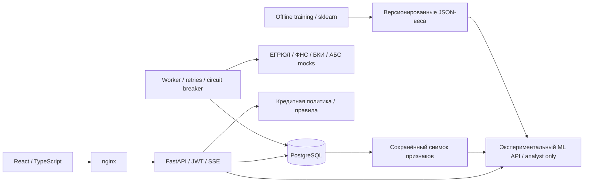
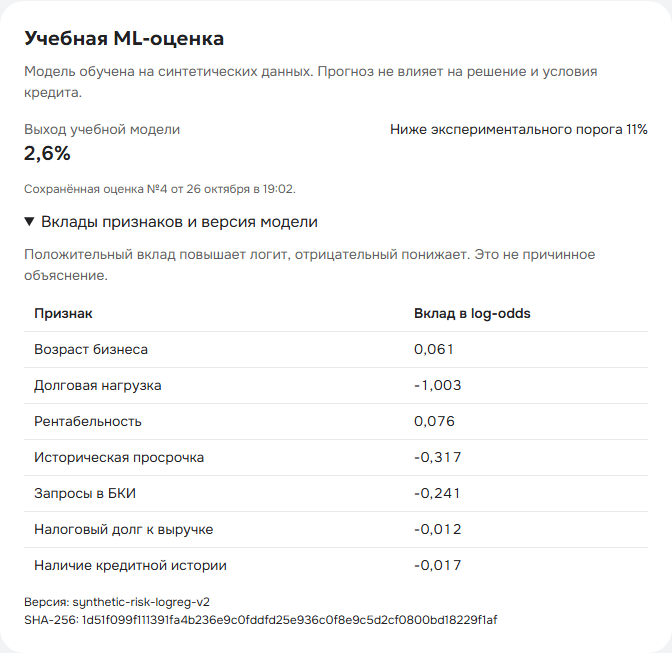

# Альфа Хакатон. Умный кредитный кабинет

[](https://github.com/MrFerrumL/alpha-smart-credit-cabinet/actions/workflows/ci.yml)
[](https://github.com/MrFerrumL/alpha-smart-credit-cabinet/actions/workflows/ml.yml)

**Backend / ML engineering portfolio · Python 3.12 · FastAPI · PostgreSQL · scikit-learn · Docker**

Кредитный кабинет для малого бизнеса: от заявки и проверки компании до решения, договора и смоделированной выдачи.
Портфолио-версия дополняет хакатонный прототип обучаемой моделью риска, воспроизводимым ML-экспериментом и API для аналитика.

Проект показывает два связанных направления разработки: устойчивый Backend кредитного процесса и полный учебный
ML-путь от генерации данных до использования модели в веб-интерфейсе. Подробный технический разбор —
[Backend design](docs/backend-design.md), схема проверок и команды — [Testing guide](docs/testing.md).


## Что можно проверить

| Backend engineering | ML engineering |
|---|---|
| REST API, OpenAPI, JWT и разграничение ролей | Logistic Regression + StandardScaler, семь признаков |
| PostgreSQL, SQLAlchemy, Alembic | Синтетические данные с вероятностной целевой переменной |
| Машина состояний и аудит заявки | Train / validation / test = 60 / 20 / 20 |
| Очередь в БД, retries, circuit breaker, идемпотентность | ROC-AUC, Average Precision, Brier score, log loss, calibration bins |
| SSE, request ID, health checks | Выбор порога на validation по стоимости ошибок |
| Тесты и Docker Compose | JSON-артефакт, SHA-256, объяснение в log-odds, training-serving parity |

**Границы:** решение по заявке принимает существующая кредитная политика на правилах. ML-прогноз доступен отдельно
через API и блок «Учебная ML-оценка» в карточке аналитика, не меняет заявку и не используется для выдачи. Необязательная LLM объясняет
решение и включается отдельно. Все данные и интеграции демонстрационные.

## Быстрый запуск

Нужны Git, Docker и Docker Compose v2.20+. Для основного стенда достаточно 8 ГБ RAM; GPU не требуется.

```bash
git clone https://github.com/MrFerrumL/alpha-smart-credit-cabinet.git
cd alpha-smart-credit-cabinet
docker compose up --build -d --wait
```

Кабинет: <http://localhost:8080> · Swagger: <http://localhost:8000/api/docs>.

Демо-вход: `bakery@demo.local` — клиент, `analyst@demo.local` — аналитик; пароль `demo1234`.
Клиент подаёт заявку на «Экспресс-оборот» и проходит путь до выдачи, аналитик видит очередь исключений.
Подробные настройки и сценарии — [RUNBOOK.md](RUNBOOK.md).

## Архитектура



Отдельный worker выполняет длительные проверки, очередь хранится в общей БД. API исполняет ML-модель обычной
математикой без scikit-learn и pickle; зависимости обучения устанавливаются отдельно.

## ML: воспроизвести эксперимент

Из корня репозитория, Python 3.12:

```bash
python -m venv .venv
# PowerShell: .venv\Scripts\Activate.ps1
# Linux/macOS: source .venv/bin/activate
python -m pip install -r backend/requirements-dev.txt -r backend/requirements-ml.txt
cd backend
python -m scripts.train_risk
python -m pytest -q ml_tests
```

Команда генерирует 12 000 строк с seed=42, обучает модель на 7 200, выбирает порог на 2 400 и оценивает
замороженную модель на оставшихся 2 400. Веса и отчёт сохраняются в `backend/app/ml/artifacts/`.
Масштабирование обучается только на train; target и идентификаторы не входят в признаки.

| Метрика на synthetic test | Модель | Константный baseline |
|---|---:|---:|
| ROC-AUC | 0.7842 | 0.5000 |
| Average Precision | 0.4540 | 0.1442 |
| Brier score ↓ | 0.1013 | 0.1234 |
| Log loss ↓ | 0.3385 | 0.4125 |

Это результат **синтетического эксперимента**, не оценка качества на реальных заёмщиках.
Полный [отчёт](backend/app/ml/artifacts/evaluation.json), [model card](docs/ml-model-card.md) и
[пример API](docs/ml-api.md) объясняют признаки, порог и ограничения.

В версии `synthetic-risk-logreg-v2` генератор учитывает бизнесы с нулевым налоговым долгом; модель хранит
диапазоны **train** и предупреждает о выходе за них. Изменение метрик относительно v1 связано с новой версией
синтетического датасета. Нельзя интерпретировать это как улучшение или ухудшение на реальном портфеле.

## Как ML используется в продукте

1. Клиент отправляет заявку. Worker получает ответы эмуляторов и сохраняет признаки для скоринга.
2. Аналитик открывает карточку: отдельный GET-запрос читает последний сохранённый снимок.
3. Adapter проверяет полноту данных и переводит налоговый долг в долю годовой выручки.
4. Модель возвращает прогноз, вклады, версию, SHA-256 и предупреждения о диапазонах обучения.
5. Интерфейс показывает результат в учебном блоке. Кредитная политика продолжает работать независимо.

При отсутствии признаков возвращается `status=unavailable`; значения не заменяются нулями. Повреждённый
JSON модели даёт безопасный `503 model_unavailable`, основной кредитный сценарий продолжает работать.

| API | Назначение | Доступ |
|---|---|---|
| `GET /api/ml/model` | Версия и идентификатор весов | Аналитик |
| `POST /api/ml/predict` | Одна строка подготовленных признаков | Аналитик |
| `POST /api/ml/predict-batch` | От 1 до 100 строк, порядок сохраняется | Аналитик |
| `GET /api/applications/{id}/ml-risk` | Прогноз из сохранённого снимка заявки | Аналитик; только отправленные заявки |

Все четыре ручки работают без записи в заявку, предложение или аудит. Новый пакет не содержит sklearn runtime:
модель в API — неизменяемый объект с проверенной схемой JSON и обычной математикой.



## Проверки

Последний локальный прогон: **815 Backend-тестов + 3 training-теста + 6 Chromium-сценариев прошли**,
один PostgreSQL-specific тест пропущен в SQLite. Покрытие строк **93.67%**, совокупное покрытие строк
и ветвей **92.42%**. Среда, пробелы и методика: [отчёт](docs/verification.md).

После установки зависимостей, из `backend/`:

```bash
python -m pytest -q
python -m pytest -q ml_tests
python -m scripts.export_openapi --check
python -m scripts.export_collection --check
python -m scripts.export_state_diagram --check
python -m coverage run -m pytest -q
python -m coverage report
```

Frontend: `cd frontend`, `npm ci`, `npm run build`. Smoke для запущенного стенда:
`python scripts/smoke.py`. GitHub Actions дополнительно проверяет PostgreSQL, миграции и браузерные сценарии;
отдельный ML workflow переобучает модель и сверяет экспорт с inference.

Локальная проверка браузера без Docker после установки Python-зависимостей и `npm ci` в `frontend/` и `e2e/`:

```bash
# из e2e/: npx playwright install chromium
# из корня проекта, с активным Python-окружением:
python scripts/run_local_e2e.py ml-risk.spec.ts analyst-card.spec.ts
```

Launcher поднимает отдельную SQLite-базу, API, mocks, worker и Vite, запускает Chromium и останавливает процессы.
Это разработческий стенд; Docker/PostgreSQL проверяются отдельно в CI. Нужны свободные порты 8000, 8001 и 18080.

## Навигация для технического интервью

- [Доработки и темы для интервью](docs/portfolio.md)
- [Подробный разбор Backend и ML-интеграции](docs/backend-design.md)
- [Стратегия тестирования и воспроизведение проверок](docs/testing.md)
- [Решения, альтернативы и компромиссы](docs/decisions.md)
- [Результаты локальной проверки](docs/verification.md)
- [Запуск, настройки и демо-сценарии](RUNBOOK.md)
- [Архитектура](docs/architecture.md), [модель данных](docs/data-model.md), [машина состояний](docs/state-machine.md)
- [API](docs/api.md), [OpenAPI](docs/openapi.json), [Postman](docs/postman_collection.json)
- [Кредитная политика](docs/scoring.md), [ML model card](docs/ml-model-card.md), [LLM](docs/llm.md)
- [Происхождение кода](PROVENANCE.md), [сторонние компоненты](THIRD_PARTY_NOTICES.md)

## Происхождение

Основа — [donaldtrumpdev-commits/alpha](https://github.com/donaldtrumpdev-commits/alpha), исходный commit
`14e1d0d3dffa81d86f2c34b0da8d57e075d05b0f`. История авторов сохранена. Новые ML-возможности и оформление
добавлены отдельными коммитами. Подробности — [PROVENANCE.md](PROVENANCE.md).
