# Модель данных

Логическая модель MVP. Типы условные — финальные выбирает команда разработки.

```mermaid
erDiagram
    COMPANY ||--o{ MEMBERSHIP : "имеет участников"
    USER ||--o{ MEMBERSHIP : "состоит в"
    COMPANY ||--o{ APPLICATION : "подаёт"
    PRODUCT ||--o{ APPLICATION : "запрошен в"
    APPLICATION ||--o{ APPLICATION_SNAPSHOT : "версии"
    APPLICATION ||--o{ CONSENT : "согласия"
    APPLICATION ||--o{ DOCUMENT : "документы"
    APPLICATION ||--o{ CHECK_RESULT : "проверки"
    APPLICATION ||--o| SCORE_RESULT : "скоринг"
    APPLICATION ||--o{ DECISION : "решения"
    APPLICATION ||--o{ INFO_REQUEST : "дозапросы"
    APPLICATION ||--o{ REVIEW_TASK : "ручная проверка"
    APPLICATION ||--o{ EVENT : "журнал"
    POLICY ||--o{ DECISION : "версия правил"

    COMPANY {
        uuid id PK
        string inn UK "10 или 12 цифр"
        string ogrn
        string form "IP | LLC"
        string name
        string okved
        string msp_category "micro | small"
        date registration_date
        string region
    }
    USER {
        uuid id PK
        string login UK
        string name
        string side "client | bank"
        string bank_role "UNDERWRITER | RISK_ANALYST | null"
        numeric approval_limit
    }
    MEMBERSHIP {
        uuid id PK
        uuid user_id FK
        uuid company_id FK
        string role "OWNER | PREPARER | VIEWER"
        string mchd_number
        date mchd_valid_to
        string[] mchd_powers "CREDIT_APPLICATION_SUBMIT, CREDIT_AGREEMENT_SIGN"
    }
    PRODUCT {
        string code PK "EXPRESS | INVEST | OVERDRAFT"
        string name
        numeric min_amount
        numeric max_amount
        int min_term
        int max_term
        int min_age_months
        numeric auto_limit
        numeric spread
        string catalog_version
    }
    APPLICATION {
        uuid id PK
        uuid company_id FK
        string product_code FK
        string purpose "CASH_GAP | WORKING_CAPITAL | EQUIPMENT | OTHER"
        string purpose_text
        numeric amount
        int term_months
        numeric declared_annual_revenue
        bool collateral
        string status
        uuid created_by FK
        uuid submitted_by FK
        int version "оптимистичная блокировка"
        timestamptz updated_at
    }
    APPLICATION_SNAPSHOT {
        uuid id PK
        uuid application_id FK
        int version
        jsonb payload "неизменяемый снимок при отправке"
        string hash
    }
    CONSENT {
        uuid id PK
        uuid application_id FK
        string type "PDN | BKI | OPEN_API"
        string text_version
        uuid given_by FK
        timestamptz given_at
    }
    DOCUMENT {
        uuid id PK
        uuid application_id FK
        string type "STATEMENT | SUPPLIER_INVOICE | OTHER"
        string file_ref
        string sha256
        uuid uploaded_by FK
        string status
    }
    CHECK_RESULT {
        uuid id PK
        uuid application_id FK
        string source "REGISTRY | FNS_PB | BKI | TURNOVER | OPEN_API | FSSP | ARBITR | FEDRESURS | MSP_REGISTRY"
        string status "OK | FAIL | TIMEOUT"
        jsonb payload
        timestamptz fetched_at
        string source_version
    }
    SCORE_RESULT {
        uuid id PK
        uuid application_id FK
        int score
        string grade "A-E"
        jsonb factors "[{code, points, value}]"
        string policy_version
    }
    DECISION {
        uuid id PK
        uuid application_id FK
        string type "APPROVED | COUNTER_OFFER | DECLINED"
        jsonb terms "{product, amount, term, rate, payment, dsr, preferential}"
        string[] reason_codes
        string decided_by "SYSTEM | user id"
        string client_comment
        string internal_comment
        timestamptz valid_until
        string policy_version FK
    }
    INFO_REQUEST {
        uuid id PK
        uuid application_id FK
        jsonb items
        string status "OPEN | FULFILLED | EXPIRED"
        timestamptz due_at
    }
    REVIEW_TASK {
        uuid id PK
        uuid application_id FK
        uuid assignee FK
        string[] reasons "M1-M4"
        timestamptz sla_due_at
        string status
    }
    EVENT {
        bigint id PK
        uuid application_id FK
        string type
        uuid actor FK
        string from_status
        string to_status
        jsonb payload
        timestamptz created_at
        bool published "outbox"
    }
    POLICY {
        string version PK
        jsonb weights
        jsonb thresholds
        jsonb rates
        timestamptz active_from
        uuid author FK
    }
```

## Правила

- `APPLICATION.status` меняется только через сервис статусов, вместе с записью в `EVENT` в одной транзакции.
- `APPLICATION_SNAPSHOT`, `CONSENT`, `EVENT`, `DECISION` — только добавление, без изменения и удаления.
- Персональные данные (паспорт руководителя и т. п.) — в отдельной таблице с ограниченным доступом; в логах маскируются.
- `DECISION.policy_version` фиксирует версию правил, по которой принято решение.
