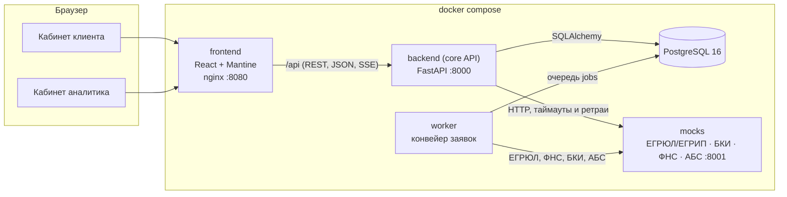
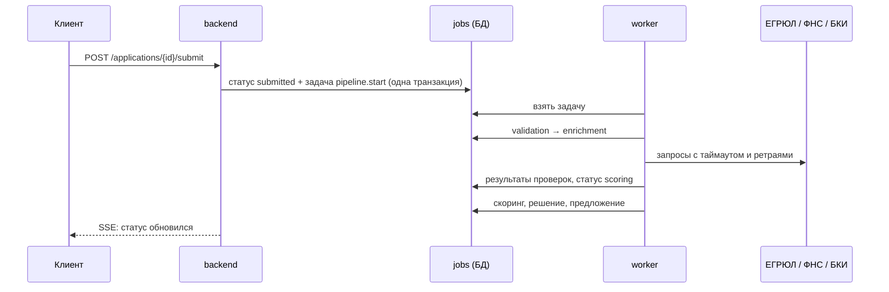
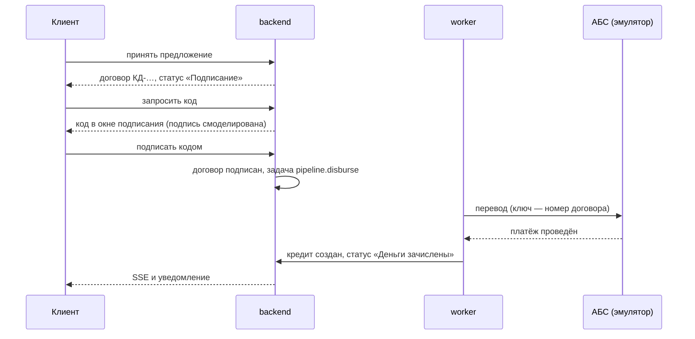

# Архитектура

## Компоненты

| Компонент | Технологии | Назначение |
|---|---|---|
| `frontend` | React 19, TypeScript, Mantine 8, TanStack Query, nginx | Веб-кабинеты клиента и аналитика. nginx раздаёт статику, проксирует `/api` и `/health` в backend, ставит заголовки безопасности, ограничивает частоту входов и пишет журнал доступа |
| `backend` | Python 3.12, FastAPI, SQLAlchemy 2, Alembic, Pydantic 2 | API: заявки, машина состояний, продукты, документы, живой статус (SSE), аудит |
| `worker` | тот же образ, `python -m app.worker` | Фоновый конвейер: проверка полноты → ЕГРЮЛ/ФНС/БКИ → оценка → решение; выдача через АБС после подписи; закрытие истёкших предложений и неотвеченных запросов банка; возврат зависших задач |
| `db` | PostgreSQL 16 | Заявки, журнал событий, результаты проверок и оценки, предложения, очередь задач конвейера |
| `mocks` | FastAPI | Эмулятор внешних систем на синтетических данных: ЕГРЮЛ, БКИ, ФНС, АБС банка; с управляемыми сбоями; фейковая OpenAI-совместимая модель для проверки пояснения в CI |
| `ollama` | Ollama 0.40.2, только с профилем `llm` | Необязательная локальная модель для пояснения решения; по умолчанию не создаётся |

Решения принимают правила кредитной политики. Языковая модель с открытыми весами нужна только для
необязательного пояснения решения, которое по умолчанию выключено: воркер после автоматического решения
отдельным потоком обращается к серверу модели, проверяет ответ по числам и исходу и сохраняет текст в
`decision_explanations`. Клиент его не ждёт. Настройка описана в [llm.md](llm.md).

## Ключевые решения

**Машина состояний в одном месте.** Статусы, переходы и права ролей на переходы описаны таблицей в
`backend/app/domain/statuses.py`. API, воркер и интерфейс опираются на неё, недопустимый переход даёт `409`.
Диаграмма в [state-machine.md](state-machine.md) собирается из этого же кода.

**Журнал аудита.** Каждое изменение статуса и каждое значимое действие пишется в `application_events`: кто,
когда, из какого статуса в какой, с каким комментарием. Из журнала строится история заявки для клиента.

**Идемпотентность и конкурентный доступ.** Отправка заявки принимает заголовок `Idempotency-Key`: повтор
запроса (двойной клик, ретрай сети) не создаёт второго события. Ключ действует в рамках своей заявки, а
интерфейс отправляет один и тот же ключ для всех попыток отправить конкретную заявку. На заявке включена оптимистическая
блокировка (`version`): параллельные изменения не перетирают друг друга, второй запрос получает `409`, а кабинет
перечитывает заявку. Повторное подтверждение подписи тем же кодом, ответ на которое не дошёл до клиента, возвращает
`200` и подписанное состояние: договор подписывается один раз, выдача ставится в очередь один раз. Выдача в АБС идёт с
`Idempotency-Key` (номер договора), так что повтор после сбоя связи не выдаёт деньги дважды, а тот же ключ с другими
реквизитами эмулятор отклоняет `409`.

**Интеграции как адаптеры.** `app/services/integrations.py` ограничивает время ответа, повторяет запрос при
сбоях с растущей паузой и различает «данных нет» (`404`) и «источник недоступен» (`5xx`, таймаут, обрыв связи).
Эмулятор умеет отвечать ошибкой или зависать по команде (`POST /admin/faults`) — так на демо видно, что сбой внешнего
сервиса не теряет заявку.

**Предохранитель источников.** Если источник лежит долго, повторять запросы к нему бессмысленно и вредно. Предохранитель
(`CircuitBreaker`) считает сбои подряд по каждому источнику отдельно: после пяти (`BREAKER_THRESHOLD`) источник
20 секунд (`BREAKER_COOLDOWN_S`) не опрашивается, шаг конвейера сразу откладывается, затем проходит один пробный запрос.
Ответ закрывает предохранитель, сбой открывает его снова. Любой ответ без `5xx`, в том числе `404` «данных нет»,
значит, что источник жив. Порог не ниже числа попыток одного шага плюс один, поэтому короткий сбой, который шаг
переживает повтором, предохранитель не открывает; `BREAKER_THRESHOLD=0` выключает его. В каждом процессе (backend,
воркер) предохранитель свой. Пока он открыт, в истории заявки стоит «… недоступен — запросы приостановлены, повторим
автоматически», в `/health/deps` источник помечен `paused`, а на странице «Состояние системы» — «на паузе». В журнал
попадают источник, номер попытки и причина, ИНН клиента в журнал интеграций не пишется. Пороги заданы значениями по
умолчанию; `docker-compose.yml` эти переменные не передаёт, чтобы их изменить, добавьте их в `environment` сервисов
`backend` и `worker`.

**Конвейер — очередь задач в той же БД.** Отправка заявки ставит задачу `pipeline.start` в таблицу `jobs` в
той же транзакции, что и смену статуса (transactional outbox), — шаг не потеряется, даже если воркер упадёт.
Воркер берёт задачи по одной (в PostgreSQL — `FOR UPDATE SKIP LOCKED`, поэтому воркеров может быть несколько),
выполняет шаг и ставит следующий. Каждый шаг ожидает заявку в определённом статусе и пропускается, если
статус уже другой (например, клиент отозвал заявку), — повторный запуск безопасен. «Зависшие» задачи
возвращаются в очередь при старте воркера. Все строки лога шага несут идентификатор `job-<id задачи>.<попытка>` и номер
заявки, поэтому шаг находится в журнале по любому из них.

**Шаг, который не удаётся выполнить.** Если проверка полноты или оценка падают на всех повторах (ошибка
в данных или коде), заявка не остаётся в конвейере: она уходит специалисту с причиной «автоматическая
обработка не завершилась». Цикл воркера переживает любую ошибку, а задачи упавшего соседнего воркера
возвращаются в очередь при плановом обслуживании раз в минуту.

**Сбой внешнего источника.** Шаг обогащения при недоступности источника откладывается с растущей паузой
(2, 4, 8, 16 с). Если источник так и не ответил за все попытки, заявка не теряется: она уходит специалисту с
пометкой, какой источник не ответил. Уже полученные ответы других источников сохраняются и не
запрашиваются повторно. Если сбой затянулся и сработал предохранитель, шаг откладывается сразу, без обращения к
источнику; повтор по-прежнему считается попыткой шага, а когда попытки кончатся, заявка уходит специалисту.

**Живой статус.** `GET /api/applications/{id}/stream` — Server-Sent Events. Токен проверяется в короткой
сессии БД, которая закрывается до начала потока, поэтому открытые вкладки не занимают соединения из пула.
Сервер раз в секунду сверяет состояние заявки в БД и отправляет событие только при изменении (плюс пинг раз в
15 секунд). Состояние берётся из БД, поэтому поток работает с любым числом экземпляров API. Фронт читает поток через `fetch` (заголовок
`Authorization`), переподключается при обрыве, а при недоступности потока опрашивает API раз в 10 секунд.

**Единый формат ошибок.** Любая ошибка API — `{status, code, title, detail, errors?}`. Интерфейс показывает
`title`/`detail` пользователю и опирается на `code` в логике.

**Наблюдаемость.** Логи backend, воркера и nginx — JSON, по строке на событие. Сквозной `X-Request-ID` присваивает
nginx (`$request_id`), backend пишет его в каждую строку и возвращает в ответе, а при обращении к внешним источникам
передаёт эмулятору, который пишет его в свой лог. Так один запрос находится в логах nginx, backend и эмулятора по
одному идентификатору. У шагов конвейера запроса нет, поэтому воркер задаёт идентификатор сам, `job-<id>.<попытка>`,
и добавляет в строки `application_id`; плановая уборка идёт под идентификатором `housekeeping`. Журнал доступа nginx
(`docker compose logs frontend`) содержит `request_id`, метод, путь без строки запроса, статус и время ответа; токенов
и ИНН в нём нет. Попытки входа пишутся с отпечатком почты (HMAC на ключе, выведенном из `SECRET_KEY`), без почты и
пароля. Проверки `/health/live` и `/health/ready` используются в healthcheck docker compose, `/health/deps` показывает
версию, очередь конвейера и состояние источников (`ok` или `paused`) и на готовность не влияет.

**Состояние системы для банка.** Страница `/system` в кабинете аналитика обновляется сама раз в 5 секунд. Источники и
очередь берутся из `/health/deps`, последние повторы и сбои шагов — из `GET /api/system/jobs`. Источник этих строк —
очередь `jobs` и журнал заявок. Текст ошибки задачи наружу не отдаётся: в нём может оказаться что угодно, вплоть до
ИНН, поэтому он сводится к короткой причине из фиксированного списка. Так сотрудник банка видит, что сработал
предохранитель или шаг выполнился со второй попытки, не заглядывая в логи.

**Договор, подпись и выдача.** Клиент принимает предложение → формируется договор (номер, условия,
график платежей по ставке предложения) → клиент запрашивает одноразовый код и подписывает договор.
Электронная подпись смоделирована: в демо-режиме сервер отдаёт код один раз, в ответе на запрос, и он
показывается прямо в окне подписания (вкладка держит его в sessionStorage до конца срока действия). SMS и
почта не используются. В БД хранится только HMAC кода на отдельном ключе, и в него входит SHA-256
условий договора и графика: подписать можно ровно те условия, которые клиент видел, а хеш условий пишется
в журнал при принятии и при подписи. Код действует 5 минут, даёт 3 попытки (списываются атомарно), новый
запрос отменяет прежний, не больше 5 кодов в час на заявку. Повторно использовать код нельзя: он гасится
условным обновлением. Принять, отказаться и подписать может только сотрудник с правом подписи, и оно дополнительно сверяется с
руководителем по выписке ЕГРЮЛ, сохранённой при подключении компании (новый руководитель по реестру,
подключившись к кабинету, обновляет запись — и прежний подписать уже не сможет). Сотрудник без
права подписи, например бухгалтер, передаёт предложение руководителю: тот получает уведомление в кабинете,
а в журнале остаётся, кто подготовил и кому передал. Руководитель с правом подписи — он же
единственный может отозвать заявку, когда у неё есть предложение банка; отзыв равен отказу — предложение
становится `declined`, и договор больше не ждёт подписи. После подписи отозвать заявку
нельзя; конвейер ставит задачу `pipeline.disburse`: перевод через АБС с номером договора как ключом
идемпотентности (заголовок `Idempotency-Key`, повтор после сбоя не приводит к двойной выдаче), создание кредита и
статус «Деньги зачислены». Пока договор не загрузился, кабинет не показывает согласие и кнопку подписи: клиент не
подписывает то, чего не видел. Если АБС не отвечает дольше всех повторов, выдача не отменяется: задача ставится заново раз в
минуту, а клиент видит «перевод задерживается». График платежей кредита детерминированно считается из
условий и даты выдачи.

**Условия выдачи по продукту.** Этапы между подписью и деньгами зависят от продукта. Для кредита с
обеспечением (инвестиционный) при принятии предложения появляются задачи-условия: загрузить документы по
залогу и подтвердить поручительство собственника; если документы по залогу уже приложены к заявке в анкете,
первое условие сразу отмечено выполненным. Договор можно подписать сразу, но задача выдачи ставится в
очередь только когда закрыто последнее условие; шаг выдачи дополнительно проверяет, что открытых условий нет.
Для продуктов без обеспечения условий нет — деньги уходят сразу после подписи. Если заявка уходит с подписания
(отзыв, истечение срока), открытые условия закрываются. Срока на закрытие условий после подписи в прототипе нет.

**Срок предложения.** Воркер раз в минуту закрывает просроченные предложения — и не принятые, и принятые, но
не подписанные (`signing → expired`). Запросить код и подписать после окончания срока нельзя. Сбой на одной
заявке (например, гонка с действием клиента) не останавливает остальные и не роняет воркер.

**Решение аналитика.** Заявка уходит специалисту, если: внешний источник не ответил, автоматическая
обработка не завершилась, компания в реорганизации, есть текущая просрочка, выручка подтверждена только
выпиской, в налоговой нет расходов, продукт с ручным решением (инвестиционный кредит) или оценка в серой
зоне (грейд C или D). Код причины
сохраняется в решении конвейера. Карточка (`GET /applications/{id}/assessment`) собирается из сохранённого
снимка признаков и результата скоринга, поэтому аналитик видит ровно то, на чём считал конвейер. Решение
(`POST /applications/{id}/decision`) проходит через ту же машину состояний (`manual_review → approved |
counter_offer | needs_info | rejected | enrichment`) и подчиняется тем же правилам, что и автоматическое:
стоп-факторы и грейд E не переопределяются, ставка не ниже ставки грейда, нагрузка не выше политики,
сумма не выше лимита по выручке для грейда и не больше запрошенной клиентом,
сумма в пределах полномочий аналитика (`ANALYST_AUTHORITY_LIMIT`, выше — кредитный комитет). Обоснование
обязательно и хранится в журнале аудита рядом с условиями, рекомендацией конвейера и признаком отклонения
от неё; клиенту показывается только сообщение для клиента. Если оценки нет из-за сбоя источника,
одобрить нельзя — аналитик отправляет заявку на повторную проверку. Двойное решение исключает блокировка
версии заявки.

В кабинете карточка открывается сводкой: «Почему у вас» (повод для ручного рассмотрения), «Конвейер рекомендует» (условия
с цифрами) и «Расхождения». Расхождений два вида: выручка со слов клиента отличается от ФНС (или выписки) больше чем на
10 % и платежи по кредитам в анкете не указаны, а в БКИ они есть. Ниже — запросы банка со статусом и ответами клиента и
документы с видом, размером и датой, чтобы не искать их в журнале. Перед сохранением решения панель «Клиент увидит»
показывает те же заголовок, цифры и причины, что появятся у клиента, а сообщение клиенту заполняется по выбранным
условиям (его можно править). Пока заявка ждёт решения, трасса правил развёрнута; после решения карточка показывает
предложенные условия, статус предложения и «Решение: <имя аналитика>, <дата>».

**Трасса и воспроизведение решения.** Вместе с решением конвейер сохраняет его трассу — правила по порядку
с результатом каждого (стоп-факторы, подтверждение выручки, скоринг, лимит по выручке с формулой, нагрузка и
покрытие, повод для специалиста, подобранные условия, итог) — и итог в сравнимом виде с версиями скоркарты и
правил. Трасса строится теми же функциями, что и решение. `POST /applications/{id}/assessment/replay` заново
прогоняет скоринг и правила на сохранённом снимке признаков и показывает, совпадает ли результат; заявку это
не меняет. Так аудит и модельный риск могут проверить, что решение воспроизводимо, а при смене правил —
увидеть, у каких заявок изменился бы исход.

**Симулятор политики.** `POST /policy/simulate` пересчитывает решения по всем заявкам с сохранённой оценкой
при других порогах (максимальная нагрузка к выручке, минимальное покрытие платежа прибылью) и показывает,
у каких заявок изменился бы исход, как сдвинулись бы доля одобрений и объём предложений. Пороги
подменяются только на время расчёта (`ContextVar` в `app/scoring/decision.py`), функции скоринга и решения —
те же, что в конвейере. Заявки, решения и журнал не меняются.

**Лента новостей (дополнительная функция).** Новостная лента в требования кейса не входит и добавлена сверх них:
основной процесс от неё не зависит. `GET /api/feed` ранжирует синтетические новости (`backend/app/data/news.json`) под
клиента: раздел ОКВЭД компании, правовая форма, регион, продукты и цели её заявок и этап главной заявки. Новости про
чужую отрасль, правовую форму или регион не показываются; у каждой новости — причины показа. Этап берётся по главной
заявке — той же, что кабинет показывает первой на главной (сначала заявка, где ход за клиентом, затем остальные идущие,
среди равных более новая; если идущих нет, то последняя закрытая). Он весит больше всех остальных совпадений вместе,
поэтому новость о том, что сейчас происходит с заявкой, всегда первая; она же получает `application_id`, и кабинет
ставит на неё метку «По вашей заявке» и ссылку на следующий шаг. Есть свои новости на проверку, одобрение,
подписание и выдачу, а для раздела «услуги населению» (химчистки, парикмахерские) — отраслевые. Над лентой строка
«Подобрано для …» показывает, по чему она собрана. У демо-компаний ИНН начинаются с «00», поэтому региональные новости
им не показываются. Лента читается под ключом заявок во фронте, поэтому обновляется вместе с ними через поток
статусов. Источник новостей смоделирован.

**Карта одобрения.** После контрпредложения или отказа без стоп-фактора `GET /api/applications/{id}/approval-map` отвечает,
сколько банк одобрит по тому же продукту на каждом стандартном сроке. Отдельной модели для этого нет: для каждого срока
сумма ищется двоичным поиском с шагом 50 тыс. ₽, признаки, зависящие от суммы и срока, пересчитываются как при оценке
новой заявки, и каждая проба проходит те же скоринг и правила решения, что и конвейер. Поэтому сумма в строке — не
прогноз: заявка на неё при тех же данных компании будет одобрена. Если продукт не проходит ни на одном сроке, карта
объясняет почему и показывает другой продукт, который банк предложит по тем же правилам. Над решением аналитика карту
не строят: он учитывает то, чего нет в правилах. Кабинет по выбранной строке создаёт новый черновик с копией анкеты,
нынешнее предложение остаётся в силе.

**Уведомления.** Когда заявку меняет банк (конвейер или аналитик), всем сотрудникам компании-клиента
приходит уведомление в кабинете; там же — напоминание, что код подписи готов (сам код в уведомления не
попадает). Фронт показывает новые уведомления всплывающим сообщением, кроме кода подписи: он уже стоит в окне
подписания. В списке последних уведомлений на главной по каждой заявке одно, последнее: прежние шаги видны в её истории.

## Безопасность

- Пароли хранятся как PBKDF2-SHA256 с солью, токены — JWT со сроком жизни 8 часов. Токен лежит в
  `sessionStorage`: у каждой вкладки своя сессия, после закрытия вкладки токен не остаётся в браузере.
  Там же, до конца срока действия, лежит последний код подписи: после перезагрузки окно подписания
  покажет его снова, а не запросит новый. На сервере открытого кода нет — только его HMAC.
- Все порты стенда по умолчанию открыты только на этой машине. Кабинет `:8080` открывается в сеть, только если
  задать `FRONTEND_BIND=0.0.0.0`; API `:8000` и эмулятор `:8001` с управлением сбоями наружу не открываются.
- Клиент видит только заявки своей компании, аналитик — только отправленные заявки (черновики — личное
  пространство клиента). Проверки доступа — на backend, а не в интерфейсе.
- Секреты и строки подключения передаются через переменные окружения (`.env.example`). Если `SECRET_KEY` не
  задан, вне окружений `local` и `test` backend при старте создаёт случайный ключ; после перезапуска backend
  пользователи входят заново.
- Контейнеры backend и mocks запускаются от непривилегированного пользователя.
- Периметр на nginx: `Content-Security-Policy` (скрипты только свои, без встроенных; запросы только к своему адресу;
  страницу нельзя встроить в чужую; на `/api/docs` и `/api/openapi.json` заголовок не отдаётся, потому что Swagger UI
  берёт скрипты с CDN), `Permissions-Policy` (камера, микрофон, геолокация, платежи и USB выключены),
  `Cross-Origin-Opener-Policy: same-origin`, `X-Content-Type-Options`, `X-Frame-Options`, `Referrer-Policy`;
  `server_tokens off` — версия nginx не раскрывается. Заголовки безопасности ставятся и к ответам с ошибкой.
- Защита входа в два слоя. nginx пускает на `/api/auth/login` с одного адреса 30 запросов в минуту с запасом на всплеск
  60, дальше отвечает `429` в формате ошибок API с `Retry-After`. Backend считает неудачи по паре «почта + адрес»:
  5 за 300 секунд закрывают вход на 300 секунд (`LOGIN_MAX_FAILURES`, `LOGIN_FAILURE_WINDOW_S`); неудачи с одного адреса
  по любым почтам, 50 за то же окно, закрывают вход с этого адреса (`LOGIN_IP_MAX_FAILURES`). Счёт идёт и для несуществующей
  почты, поэтому ответ не выдаёт, есть ли такой пользователь, а посторонний со своего адреса не закроет вход владельцу.
  Адрес клиента backend берёт из `X-Real-IP`, который nginx выставляет сам, а порт `:8000` снаружи недоступен.
  Счётчики хранятся в памяти процесса: для прототипа этого хватает, при нескольких экземплярах backend нужно общее
  хранилище (Redis). `docker-compose.yml` эти переменные не передаёт.
- В журнал входа попадает отпечаток почты (HMAC на ключе, выведенном из `SECRET_KEY` под эту задачу), а не сама почта:
  по нему видно, что неудачи относятся к одной почте, а почту по нему не подобрать. Хеш для счётчика посчитан с
  другой меткой, чтобы он не совпадал с отпечатком из логов.
- Демо-режим (`DEMO_MODE=true`, по умолчанию) включает демо-учётки и вход в один клик, Swagger и OpenAPI и показ
  кода подписи в окне. При `DEMO_MODE=false` демо-учётки не создаются, Swagger и OpenAPI не отдаются, код подписи
  не показывается.
- Подключить компанию к кабинету может только её руководитель или учредитель по данным ЕГРЮЛ. Полномочия
  проверяются раньше, чем то, подключена ли компания: посторонний получает `403` и не может перебором ИНН
  узнать, кто из компаний уже клиент банка. К уже подключённой компании может присоединиться только
  руководитель (остальные получают `409`) — иначе учредитель, подключившийся первым, закрыл бы вход
  директору; подключённые сотрудники получают уведомление. Право подписи договора получает только руководитель.
  Личность в прототипе сверяется по ФИО.
- Токен без обязательных полей (`sub`, `exp`) отклоняется с `401`, а не приводит к ошибке сервера.
- Номер заявки, кредита или запроса банка вне диапазона ключей даёт `404`, а не ошибку сервера.
- Документы проверяются по типу и размеру (до 10 МБ) и хранятся вне веб-корня под случайными именами.
- Сырые ответы внешних источников видит только сотрудник банка; клиенту — статусы проверок и объяснения.

## Масштабирование и сопровождение

- Состояние заявок backend не держит в памяти — его можно запускать в нескольких экземплярах за балансировщиком
  (с общим `SECRET_KEY`). Исключение — два счётчика, у каждого процесса свой: неудачные входы и предохранитель
  источников. Для прототипа это приемлемо, для продакшена их выносят в общее хранилище.
- Схема БД меняется только миграциями Alembic (`backend/migrations`). В PostgreSQL миграции идут под рекомендательной
  блокировкой (`pg_advisory_xact_lock`): две реплики backend, стартующие одновременно, не мигрируют разом, вторая ждёт,
  пока первая зафиксирует транзакцию, и видит уже применённые версии.
- Остановка не обрывает работу. uvicorn при `SIGTERM` доделывает открытые запросы не дольше 10 секунд
  (`--timeout-graceful-shutdown 10`), потоки SSE, не закрывшиеся сами, обрываются, кабинет переподключается. Контейнеру
  backend `docker compose` даёт на остановку 20 секунд (`stop_grace_period`), воркеру — 45: он доделывает текущий шаг.
  Процесс запускается через `exec`, чтобы сигнал получил uvicorn, а не оболочка.
- Каждый маршрут API либо открыт по явному решению, либо требует входа: тест `test_route_guards.py` обходит все
  маршруты приложения и сверяет их со списком открытых, а также проверяет, что клиент не попадёт на ручки аналитика и
  наоборот.
- Версии зависимостей зафиксированы: `backend/requirements.txt`, `mocks/requirements.txt`,
  `frontend/package-lock.json`, образы в Dockerfile — с точными тегами.

## Что в продакшене иначе

- Токен в httpOnly-cookie, короткоживущий, с обновлением, а не в `sessionStorage`.
- Личность и право подписи сверяются по ИНН физлица из сертификата электронной подписи, а не по ФИО.
- Документы лежат в объектном хранилище и проходят антивирусную проверку.
- Изменение порогов политики проходит согласование и выпускается новой версией правил; симулятор оценивает
  влияние до этого.
- У условий выдачи есть срок: не закрыл вовремя — заявка уходит специалисту.
- Новости — редакционный контент банка с той же разметкой.
- При росте нагрузки очередь задач выносится в брокер сообщений без изменения шагов конвейера.
