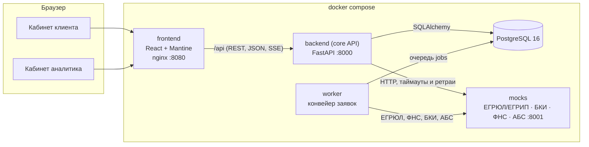
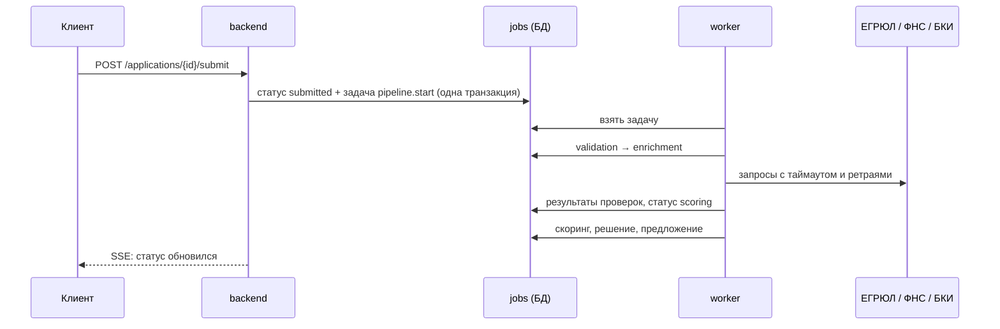
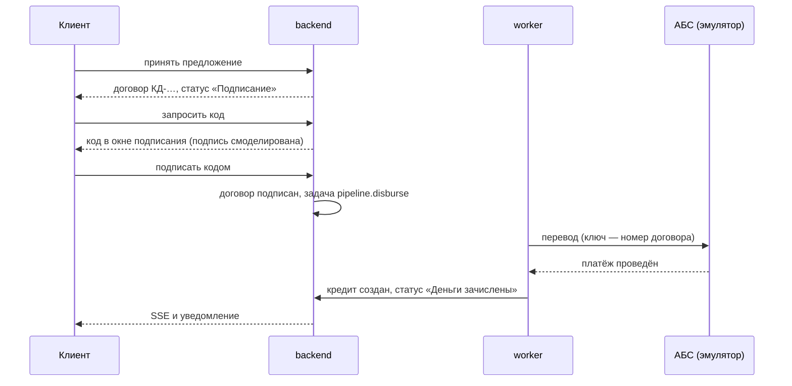

# Архитектура

## Компоненты

| Компонент | Технологии | Назначение |
|---|---|---|
| `frontend` | React 19, TypeScript, Mantine 8, TanStack Query, nginx | Веб-кабинеты клиента и аналитика. nginx раздаёт статику и проксирует `/api` в backend |
| `backend` | Python 3.12, FastAPI, SQLAlchemy 2, Alembic, Pydantic 2 | API: заявки, машина состояний, продукты, документы, живой статус (SSE), аудит |
| `worker` | тот же образ, `python -m app.worker` | Фоновый конвейер: проверка полноты → ЕГРЮЛ/ФНС/БКИ → оценка → решение; выдача через АБС после подписи; закрытие истёкших предложений и неотвеченных запросов банка; возврат зависших задач |
| `db` | PostgreSQL 16 | Заявки, журнал событий, результаты проверок и оценки, предложения, очередь задач конвейера |
| `mocks` | FastAPI | Эмулятор внешних систем на синтетических данных: ЕГРЮЛ, БКИ, ФНС, АБС банка; с управляемыми сбоями |

ML-моделей и LLM в решении нет; что может появиться дальше — в разделе «Развитие» README.

## Ключевые решения

**Машина состояний — единственный источник правды.** Статусы, переходы и права ролей на переходы описаны
таблицей в `backend/app/domain/statuses.py`. API, воркер и интерфейс опираются на неё, недопустимый переход
даёт `409`. Диаграмма в [state-machine.md](state-machine.md) собирается из этого же кода.

**Журнал аудита.** Каждое изменение статуса и каждое значимое действие пишется в `application_events`: кто,
когда, из какого статуса в какой, с каким комментарием. Из журнала строится история заявки для клиента.

**Идемпотентность и конкурентный доступ.** Отправка заявки принимает заголовок `Idempotency-Key`: повтор
запроса (двойной клик, ретрай сети) не создаёт второго события. Ключ действует в рамках своей заявки, а
интерфейс отправляет один и тот же ключ для всех попыток отправить конкретную заявку. На заявке включена оптимистическая
блокировка (`version`): параллельные изменения не перетирают друг друга, второй запрос получает `409`.

**Интеграции как адаптеры.** `app/services/integrations.py` ограничивает время ответа, повторяет запрос при
сбоях с растущей паузой и различает «данных нет» (`404`) и «источник недоступен» (`503`). Эмулятор умеет
отвечать ошибкой или зависать по команде (`POST /admin/faults`) — так на демо видно, что сбой внешнего
сервиса не теряет заявку.

**Конвейер — очередь задач в той же БД.** Отправка заявки ставит задачу `pipeline.start` в таблицу `jobs` в
той же транзакции, что и смену статуса (transactional outbox), — шаг не потеряется, даже если воркер упадёт.
Воркер берёт задачи по одной (в PostgreSQL — `FOR UPDATE SKIP LOCKED`, поэтому воркеров может быть несколько),
выполняет шаг и ставит следующий. Каждый шаг ожидает заявку в определённом статусе и пропускается, если
статус уже другой (например, клиент отозвал заявку), — повторный запуск безопасен. «Зависшие» задачи
возвращаются в очередь при старте воркера. При росте нагрузки очередь выносится в брокер (RabbitMQ/Kafka) без
изменения шагов.

**Шаг, который не удаётся выполнить.** Если проверка полноты или оценка падают на всех повторах (ошибка
в данных или коде), заявка не остаётся в конвейере: она уходит специалисту с причиной «автоматическая
обработка не завершилась». Цикл воркера переживает любую ошибку, а задачи упавшего соседнего воркера
возвращаются в очередь при плановом обслуживании раз в минуту.

**Сбой внешнего источника.** Шаг обогащения при недоступности источника откладывается с растущей паузой
(2, 4, 8, 16 с). Если источник так и не ответил за все попытки, заявка не теряется: она уходит специалисту с
пометкой, какой источник не ответил. Уже полученные ответы других источников сохраняются и не
запрашиваются повторно.

**Живой статус.** `GET /api/applications/{id}/stream` — Server-Sent Events. Токен проверяется в короткой
сессии БД, которая закрывается до начала потока, поэтому открытые вкладки не занимают соединения из пула. Сервер раз в секунду сверяет
состояние заявки в БД и отправляет событие только при изменении (плюс пинг раз в 15 секунд). Источник истины —
БД, поэтому поток работает с любым числом экземпляров API. Фронт читает поток через `fetch` (заголовок
`Authorization`), переподключается при обрыве, а при недоступности потока опрашивает API раз в 10 секунд.

**Единый формат ошибок.** Любая ошибка API — `{status, code, title, detail, errors?}`. Интерфейс показывает
`title`/`detail` пользователю и опирается на `code` в логике.

**Наблюдаемость.** JSON-логи, сквозной `X-Request-ID` (проставляет nginx, прокидывает backend), проверки
`/health/live` и `/health/ready` используются в healthcheck docker compose.

**Договор, подпись и выдача.** Клиент принимает предложение → формируется договор (номер, условия,
график платежей по ставке предложения) → клиент запрашивает одноразовый код и подписывает договор.
Электронная подпись смоделирована: сервер отдаёт код один раз, в ответе на запрос, и он показывается прямо
в окне подписания (вкладка держит его в sessionStorage до конца срока действия), SMS и почта по условиям
задачи не используются. В БД хранится только HMAC кода на отдельном ключе, и в него входит SHA-256
условий договора и графика: подписать можно ровно те условия, которые клиент видел, а хеш условий пишется
в журнал при принятии и при подписи. Код действует 5 минут, даёт 3 попытки (списываются атомарно), новый
запрос отменяет прежний, не больше 5 кодов в час на заявку. Повторно использовать код нельзя: он гасится
условным обновлением. Принять, отказаться и подписать может только сотрудник с правом подписи, и оно дополнительно сверяется с
руководителем по выписке ЕГРЮЛ, сохранённой при подключении компании (новый руководитель по реестру,
подключившись к кабинету, обновляет запись — и прежний подписать уже не сможет). Сотрудник без
права подписи, например бухгалтер, передаёт предложение руководителю: тот получает уведомление в кабинете,
а в журнале остаётся, кто подготовил и кому передал. Руководитель с правом подписи — он же
единственный может отозвать заявку, когда у неё есть предложение банка; отзыв равен отказу — предложение
становится `declined`, и договор больше не ждёт подписи. После подписи отозвать заявку
нельзя; конвейер ставит задачу `pipeline.disburse`: перевод через АБС с номером договора как ключом
идемпотентности (повтор после сбоя не приводит к двойной выдаче), создание кредита и статус «Деньги
зачислены». Если АБС не отвечает дольше всех повторов, выдача не отменяется: задача ставится заново раз в
минуту, а клиент видит «перевод задерживается». График платежей кредита детерминированно считается из
условий и даты выдачи.

**Условия выдачи по продукту.** Этапы между подписью и деньгами зависят от продукта. Для кредита с
обеспечением (инвестиционный) при принятии предложения появляются задачи-условия: загрузить документы по
залогу и подтвердить поручительство собственника; если документы по залогу уже приложены к заявке в анкете,
первое условие сразу отмечено выполненным. Договор можно подписать сразу, но задача выдачи ставится в
очередь только когда закрыто последнее условие; шаг выдачи дополнительно проверяет, что открытых условий нет.
Для продуктов без обеспечения условий нет — деньги уходят сразу после подписи. Если заявка уходит с подписания
(отзыв, истечение срока), открытые условия закрываются. Срока на закрытие условий после подписи в прототипе нет —
в промышленной версии это срок действия решения с передачей заявки специалисту.

**Срок предложения.** Воркер раз в минуту закрывает просроченные предложения — и не принятые, и принятые, но
не подписанные (`signing → expired`). Запросить код и подписать после окончания срока нельзя. Сбой на одной
заявке (например, гонка с действием клиента) не останавливает остальные и не роняет воркер.

**Решение аналитика.** Заявка уходит специалисту, если: внешний источник не ответил, автоматическая
обработка не завершилась, компания в реорганизации, есть текущая просрочка, выручка подтверждена только
выпиской, в налоговой нет расходов, продукт с ручным решением (инвестиционный кредит) или оценка в серой
зоне (грейд C или D). Код причины
сохраняется в решении конвейера. Карточка (`GET /applications/{id}/assessment`) собирается из сохранённого
снимка признаков и результата скоринга, поэтому аналитик видит ровно то, на чём считал конвейер. Решение
(`POST /applications/{id}/decision`) проходит через ту же машину состояний (`manual_review → approved |
counter_offer | needs_info | rejected | enrichment`) и подчиняется тем же правилам, что и автоматическое:
стоп-факторы и грейд E не переопределяются, ставка не ниже ставки грейда, нагрузка не выше политики,
сумма не выше лимита по выручке для грейда и не больше запрошенной клиентом,
сумма в пределах полномочий аналитика (`ANALYST_AUTHORITY_LIMIT`, выше — кредитный комитет). Обоснование
обязательно и хранится в журнале аудита рядом с условиями, рекомендацией конвейера и признаком отклонения
от неё; клиенту показывается только сообщение для клиента. Если оценки нет из-за сбоя источника,
одобрить нельзя — аналитик отправляет заявку на повторную проверку. Двойное решение исключает блокировка
версии заявки.

**Трасса и воспроизведение решения.** Вместе с решением конвейер сохраняет его трассу — правила по порядку
с результатом каждого (стоп-факторы, подтверждение выручки, скоринг, лимит по выручке с формулой, нагрузка и
покрытие, повод для специалиста, подобранные условия, итог) — и итог в сравнимом виде с версиями скоркарты и
правил. Трасса строится теми же функциями, что и решение. `POST /applications/{id}/assessment/replay` заново
прогоняет скоринг и правила на сохранённом снимке признаков и показывает, совпадает ли результат; заявку это
не меняет. Так аудит и модельный риск могут проверить, что решение воспроизводимо, а при смене правил —
увидеть, у каких заявок изменился бы исход.

**Симулятор политики.** `POST /policy/simulate` пересчитывает решения по всем заявкам с сохранённой оценкой
при других порогах (максимальная нагрузка к выручке, минимальное покрытие платежа прибылью) и показывает,
у каких заявок изменился бы исход, как сдвинулись бы доля одобрений и объём предложений. Пороги
подменяются только на время расчёта (`ContextVar` в `app/scoring/decision.py`), функции скоринга и решения —
те же, что в конвейере. Заявки, решения и журнал не меняются. В промышленной версии изменение порогов
проходит согласование и выпускается новой версией правил; симулятор даёт оценку влияния до этого.

**Лента новостей.** `GET /api/feed` ранжирует синтетические новости (`backend/app/data/news.json`) под
клиента: раздел ОКВЭД компании, правовая форма, регион, продукты и цели её заявок, текущие статусы заявок.
Новости про чужую отрасль, правовую форму или регион не показываются; у каждой новости — причины показа.
Статус учитывается по самой свежей заявке и весит больше отрасли: что сейчас происходит с заявкой — то и
наверху. У демо-компаний ИНН начинаются с «00», поэтому региональные новости им не показываются.
Лента читается под ключом заявок во фронте, поэтому обновляется вместе с ними через поток статусов. Источник
новостей смоделирован; в промышленной версии это редакционный контент банка с той же разметкой.

**Уведомления.** Когда заявку меняет банк (конвейер или аналитик), всем сотрудникам компании-клиента
приходит уведомление в кабинете; там же — напоминание, что код подписи готов (сам код в уведомления не
попадает). Фронт показывает новые уведомления всплывающим сообщением.

## Безопасность

- Пароли хранятся как PBKDF2-SHA256 с солью, токены — JWT с ограниченным сроком жизни. Токен лежит в
  `sessionStorage`: у каждой вкладки своя сессия, после закрытия вкладки токен не остаётся в браузере.
  Там же, до конца срока действия, лежит последний код подписи: после перезагрузки окно подписания
  покажет его снова, а не запросит новый. На сервере открытого кода нет — только его HMAC.
  В промышленной версии — httpOnly-cookie и короткоживущий токен с обновлением.
- Наружу (на все сетевые интерфейсы) опубликован только кабинет `:8080`; API `:8000` и эмулятор `:8001`
  с управлением сбоями доступны лишь с этой машины.
- Клиент видит только заявки своей компании, аналитик — только отправленные заявки (черновики — личное
  пространство клиента). Проверки доступа — на backend, а не в интерфейсе.
- Секреты и строки подключения передаются через переменные окружения (`.env.example`).
- Контейнеры backend и mocks запускаются от непривилегированного пользователя; nginx добавляет базовые
  заголовки безопасности.
- Список демо-профилей на странице входа и вход без пароля отключаются переменной `DEMO_MODE=false`.
- Подключить компанию к кабинету может только её руководитель или учредитель по данным ЕГРЮЛ. Полномочия
  проверяются раньше, чем то, подключена ли компания: посторонний получает `403` и не может перебором ИНН
  узнать, кто из компаний уже клиент банка. К уже подключённой компании может присоединиться только
  руководитель (остальные получают `409`) — иначе учредитель, подключившийся первым, закрыл бы вход
  директору; подключённые сотрудники получают уведомление. Право подписи договора получает только руководитель. В прототипе
  личность сверяется по ФИО, в промышленной версии — по ИНН физлица из сертификата электронной подписи.
- Токен без обязательных полей (`sub`, `exp`) отклоняется с `401`, а не приводит к ошибке сервера.
- Номер заявки, кредита или запроса банка вне диапазона ключей даёт `404`, а не ошибку сервера.
- Документы проверяются по расширению и размеру (до 10 МБ), хранятся вне веб-корня под случайными именами.
  В промышленной версии — объектное хранилище и антивирусная проверка.
- Сырые ответы внешних источников видит только сотрудник банка; клиенту — статусы проверок и объяснения.

## Масштабирование и сопровождение

- backend не хранит состояние в памяти — его можно запускать в нескольких экземплярах за балансировщиком.
- Схема БД меняется только миграциями Alembic (`backend/migrations`).
- Версии зависимостей зафиксированы: `backend/requirements.txt`, `mocks/requirements.txt`,
  `frontend/package-lock.json`, образы в Dockerfile — с точными тегами.
