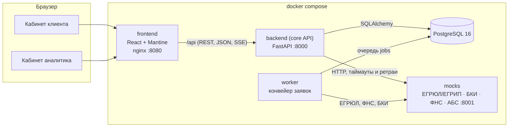
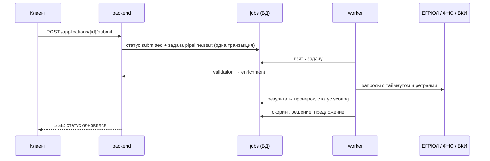
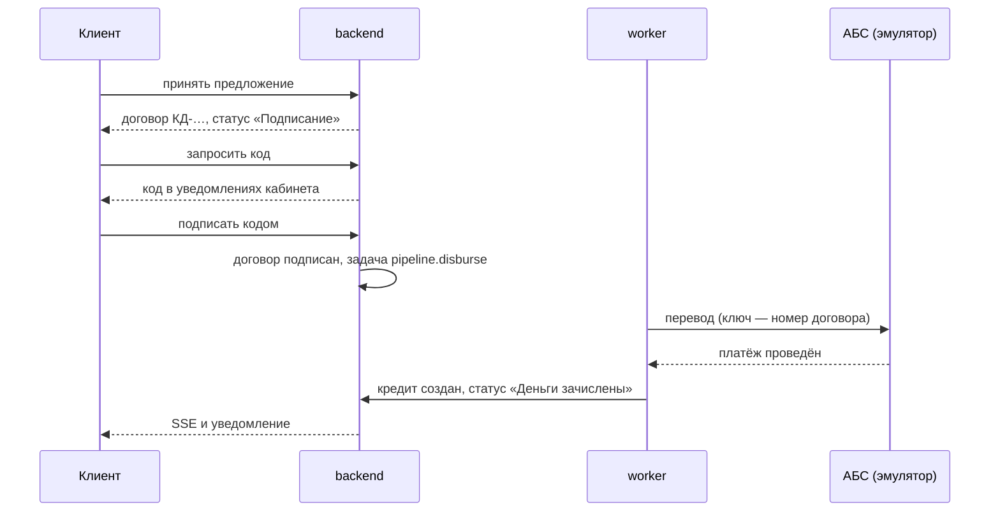

# Архитектура

## Компоненты

| Компонент | Технологии | Назначение |
|---|---|---|
| `frontend` | React 19, TypeScript, Mantine 8, TanStack Query, nginx | Веб-кабинеты клиента и аналитика. nginx раздаёт статику и проксирует `/api` в backend |
| `backend` | Python 3.12, FastAPI, SQLAlchemy 2, Alembic, Pydantic 2 | API: заявки, машина состояний, продукты, документы, живой статус (SSE), аудит |
| `worker` | тот же образ, `python -m app.worker` | Фоновый конвейер: проверка полноты → ЕГРЮЛ/ФНС/БКИ → оценка → решение; выдача после подписи; закрытие истёкших предложений |
| `db` | PostgreSQL 16 | Заявки, журнал событий, результаты проверок и оценки, предложения, очередь задач конвейера |
| `mocks` | FastAPI | Эмулятор внешних систем на синтетических данных: ЕГРЮЛ, БКИ, ФНС, АБС банка; с управляемыми сбоями |

Дальше по плану добавятся сервисы `ml-scoring` (модель вероятности дефолта) и `assistant` (LLM с открытыми весами).

## Ключевые решения

**Машина состояний — единственный источник правды.** Статусы, переходы и права ролей на переходы описаны
таблицей в `backend/app/domain/statuses.py`. API, воркер и интерфейс опираются на неё, недопустимый переход
даёт `409`. Диаграмма в [state-machine.md](state-machine.md) собирается из этого же кода.

**Журнал аудита.** Каждое изменение статуса и каждое значимое действие пишется в `application_events`: кто,
когда, из какого статуса в какой, с каким комментарием. Из журнала строится история заявки для клиента.

**Идемпотентность и конкурентный доступ.** Отправка заявки принимает заголовок `Idempotency-Key`: повтор
запроса (двойной клик, ретрай сети) не создаёт второго события. Ключ действует в рамках своей заявки, а
интерфейс отправляет один и тот же ключ для всех попыток отправить конкретную заявку. На заявке включена оптимистическая
блокировка (`version`): параллельные изменения не перетирают друг друга, второй запрос получает `409`.

**Интеграции как адаптеры.** `app/services/integrations.py` ограничивает время ответа, повторяет запрос при
сбоях с растущей паузой и различает «данных нет» (`404`) и «источник недоступен» (`503`). Эмулятор умеет
отвечать ошибкой или зависать по команде (`POST /admin/faults`) — так на демо видно, что сбой внешнего
сервиса не теряет заявку.

**Конвейер — очередь задач в той же БД.** Отправка заявки ставит задачу `pipeline.start` в таблицу `jobs` в
той же транзакции, что и смену статуса (transactional outbox), — шаг не потеряется, даже если воркер упадёт.
Воркер берёт задачи по одной (в PostgreSQL — `FOR UPDATE SKIP LOCKED`, поэтому воркеров может быть несколько),
выполняет шаг и ставит следующий. Каждый шаг ожидает заявку в определённом статусе и пропускается, если
статус уже другой (например, клиент отозвал заявку), — повторный запуск безопасен. «Зависшие» задачи
возвращаются в очередь при старте воркера. При росте нагрузки очередь выносится в брокер (RabbitMQ/Kafka) без
изменения шагов.

**Сбой внешнего источника.** Шаг обогащения при недоступности источника откладывается с растущей паузой
(2, 4, 8, 16 с). Если источник так и не ответил за все попытки, заявка не теряется: она уходит специалисту с
пометкой, какой источник не ответил. Уже полученные ответы других источников сохраняются и не
запрашиваются повторно.

**Живой статус.** `GET /api/applications/{id}/stream` — Server-Sent Events. Токен проверяется в короткой
сессии БД, которая закрывается до начала потока, поэтому открытые вкладки не занимают соединения из пула. Сервер раз в секунду сверяет
состояние заявки в БД и отправляет событие только при изменении (плюс пинг раз в 15 секунд). Источник истины —
БД, поэтому поток работает с любым числом экземпляров API. Фронт читает поток через `fetch` (заголовок
`Authorization`), переподключается при обрыве, а при недоступности потока опрашивает API раз в 10 секунд.

**Единый формат ошибок.** Любая ошибка API — `{status, code, title, detail, errors?}`. Интерфейс показывает
`title`/`detail` пользователю и опирается на `code` в логике.

**Наблюдаемость.** JSON-логи, сквозной `X-Request-ID` (проставляет nginx, прокидывает backend), проверки
`/health/live` и `/health/ready` используются в healthcheck docker compose.

**Договор, подпись и выдача.** Клиент принимает предложение → формируется договор (номер, условия,
график платежей по ставке предложения) → клиент запрашивает одноразовый код и подписывает договор. Код
приходит в уведомления кабинета: SMS и почта по условиям задачи не используются. В БД хранится только HMAC
кода; код действует 5 минут, даёт 3 попытки, новый запрос отменяет прежний. Принять и подписать может только
сотрудник с правом подписи. После подписи отозвать заявку нельзя; конвейер ставит задачу `pipeline.disburse`:
перевод через АБС с номером договора как ключом идемпотентности (повтор после сбоя не приводит к двойной
выдаче), создание кредита и статус «Деньги зачислены». График платежей кредита детерминированно
считается из условий и даты выдачи.

**Уведомления.** Когда заявку меняет банк (конвейер или аналитик), всем сотрудникам компании-клиента
приходит уведомление в кабинете; там же — коды подписи. Фронт показывает новые уведомления всплывающим
сообщением.

## Безопасность

- Пароли хранятся как PBKDF2-SHA256 с солью, токены — JWT с ограниченным сроком жизни.
- Клиент видит только заявки своей компании, аналитик — только отправленные заявки (черновики — личное
  пространство клиента). Проверки доступа — на backend, а не в интерфейсе.
- Секреты и строки подключения передаются через переменные окружения (`.env.example`).
- Контейнеры backend и mocks запускаются от непривилегированного пользователя; nginx добавляет базовые
  заголовки безопасности.
- Демо-вход в один клик отключается переменной `DEMO_MODE=false`.
- Подключить компанию к кабинету может только её руководитель или учредитель по данным ЕГРЮЛ, и только
  если компания ещё не подключена. Право подписи договора получает только руководитель. В прототипе
  личность сверяется по ФИО, в промышленной версии — по ИНН физлица из сертификата электронной подписи.
- Токен без обязательных полей (`sub`, `exp`) отклоняется с `401`, а не приводит к ошибке сервера.
- Документы проверяются по расширению и размеру (до 10 МБ), хранятся вне веб-корня под случайными именами.
  В промышленной версии — объектное хранилище и антивирусная проверка.
- Сырые ответы внешних источников видит только сотрудник банка; клиенту — статусы проверок и объяснения.

## Масштабирование и сопровождение

- backend не хранит состояние в памяти — его можно запускать в нескольких экземплярах за балансировщиком.
- Схема БД меняется только миграциями Alembic (`backend/migrations`).
- Версии зависимостей зафиксированы: `backend/requirements.txt`, `mocks/requirements.txt`,
  `frontend/package-lock.json`, образы в Dockerfile — с точными тегами.
