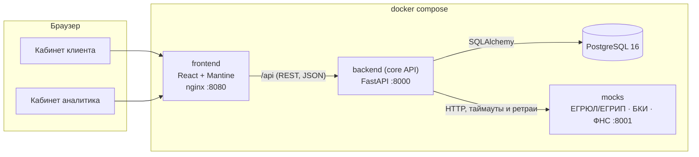

# Архитектура

## Компоненты

| Компонент | Технологии | Назначение |
|---|---|---|
| `frontend` | React 19, TypeScript, Mantine 8, TanStack Query, nginx | Веб-кабинеты клиента и аналитика. nginx раздаёт статику и проксирует `/api` в backend |
| `backend` | Python 3.12, FastAPI, SQLAlchemy 2, Alembic, Pydantic 2 | Ядро конвейера: заявки, машина состояний, продукты, интеграции, аудит |
| `db` | PostgreSQL 16 | Заявки, журнал событий, результаты проверок, очередь задач конвейера |
| `mocks` | FastAPI | Эмулятор внешних источников на синтетических данных, с управляемыми сбоями |

Дальше по плану добавятся сервисы `ml-scoring` (модель вероятности дефолта) и `assistant` (LLM с открытыми весами).

## Ключевые решения

**Машина состояний — единственный источник правды.** Статусы, переходы и права ролей на переходы описаны
таблицей в `backend/app/domain/statuses.py`. API, воркер и интерфейс опираются на неё, недопустимый переход
даёт `409`. Диаграмма в [state-machine.md](state-machine.md) собирается из этого же кода.

**Журнал аудита.** Каждое изменение статуса и каждое значимое действие пишется в `application_events`: кто,
когда, из какого статуса в какой, с каким комментарием. Из журнала строится история заявки для клиента.

**Идемпотентность и конкурентный доступ.** Отправка заявки принимает заголовок `Idempotency-Key`: повтор
запроса (двойной клик, ретрай сети) не создаёт второго события. На заявке включена оптимистическая
блокировка (`version`): параллельные изменения не перетирают друг друга, второй запрос получает `409`.

**Интеграции как адаптеры.** `app/services/integrations.py` ограничивает время ответа, повторяет запрос при
сбоях с растущей паузой и различает «данных нет» (`404`) и «источник недоступен» (`503`). Эмулятор умеет
отвечать ошибкой или зависать по команде (`POST /admin/faults`) — так на демо видно, что сбой внешнего
сервиса не теряет заявку.

**Очередь конвейера в той же БД** *(подключается на шаге 2)*. Таблица `jobs` — transactional outbox: шаг
конвейера ставится в очередь в той же транзакции, что и смена статуса, поэтому не теряется при падении
воркера. Для прототипа этого достаточно; при росте нагрузки очередь выносится в брокер (RabbitMQ/Kafka) без
изменения доменной логики.

**Единый формат ошибок.** Любая ошибка API — `{status, code, title, detail, errors?}`. Интерфейс показывает
`title`/`detail` пользователю и опирается на `code` в логике.

**Наблюдаемость.** JSON-логи, сквозной `X-Request-ID` (проставляет nginx, прокидывает backend), проверки
`/health/live` и `/health/ready` используются в healthcheck docker compose.

## Безопасность

- Пароли хранятся как PBKDF2-SHA256 с солью, токены — JWT с ограниченным сроком жизни.
- Клиент видит только заявки своей компании, аналитик — только отправленные заявки (черновики — личное
  пространство клиента). Проверки доступа — на backend, а не в интерфейсе.
- Секреты и строки подключения передаются через переменные окружения (`.env.example`).
- Контейнеры backend и mocks запускаются от непривилегированного пользователя; nginx добавляет базовые
  заголовки безопасности.
- Демо-вход в один клик отключается переменной `DEMO_MODE=false`.

## Масштабирование и сопровождение

- backend не хранит состояние в памяти — его можно запускать в нескольких экземплярах за балансировщиком.
- Схема БД меняется только миграциями Alembic (`backend/migrations`).
- Версии зависимостей зафиксированы: `backend/requirements.txt`, `mocks/requirements.txt`,
  `frontend/package-lock.json`, образы в Dockerfile — с точными тегами.
