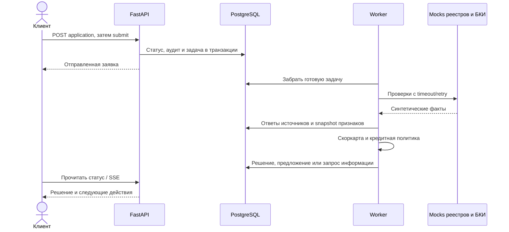
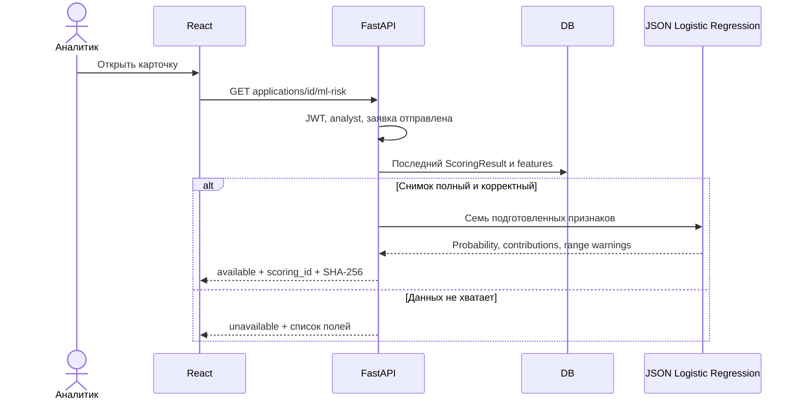

# Backend: устройство, гарантии и путь заявки

## Границы системы

Проект объединяет клиентский путь МСБ и внутреннюю обработку банка. Клиент выбирает продукт, подаёт анкету,
отвечает на запросы и подписывает предложение. Аналитик получает исключения, проверяет факты и принимает
решение с обоснованием. Внешние реестры, БКИ и выдача денег смоделированы отдельным HTTP-сервисом.

| Слой | Файлы | Ответственность |
|---|---|---|
| HTTP | `backend/app/api/` | Маршруты, роли, схемы, преобразование запроса/ответа |
| Services | `backend/app/services/` | Заявки, решения, документы, подпись, уведомления |
| Domain | `backend/app/domain/` | Продукты, полномочия, статусы и ограничения |
| Pipeline | `backend/app/pipeline/` | Очередь, выполнение шагов, повторы, восстановление |
| Rule scoring | `backend/app/scoring/` | Признаки, скоркарта, политика, предложение |
| ML | `backend/app/ml/` | Контракт признаков, JSON inference, adapter снимка |
| Persistence | `models.py`, `db.py`, `migrations/` | ORM, сессии, транзакции, эволюция схемы |

Маршруты делегируют бизнес-логику сервисам. У FastAPI явные зависимости для сессии БД, пользователя,
роли и интеграций. Тесты подменяют HTTP-источники через dependency override и гоняют тот же конвейер.

## Основной поток

После принятия предложения договор и график формируются из согласованных условий. Подписание подтверждается
одноразовым кодом внутри продукта. Задача выдачи обращается к эмулятору АБС; после завершения появляется кредит.
Полные состояния и переходы: [state-machine.md](state-machine.md).

## Транзакции и конкурентный доступ

Задача ставится в очередь в той же БД, что хранит заявку. Вставка `Job`, смена статуса и аудит фиксируются
совместно на соответствующих шагах. Это сокращает окно потери работы между записью заявки и внешним брокером.
В `claim_next` PostgreSQL использует `FOR UPDATE SKIP LOCKED`: другой worker может взять следующую задачу,
пока первая заблокирована. SQLite-стенд не доказывает корректность этой конкуренции.

Заявка имеет version counter SQLAlchemy для оптимистической блокировки. При конфликте API возвращает ошибку,
а frontend обновляет данные. Повторная отправка защищена ключом идемпотентности в контексте заявки.
Идемпотентность подписи и выдачи рассматривается отдельно от ключа подачи заявки.

Worker фиксирует номер попытки. Результат старой попытки отбрасывается, если задачу уже восстановили и
передали другому запуску. Это важнее обещания «каждый job выполнится ровно один раз»: шаг может быть
повторён, поэтому его бизнес-эффекты должны учитывать повторное исполнение.

## Сбои и восстановление

| Сбой | Поведение | Где проверяется |
|---|---|---|
| Источник не ответил вовремя | Timeout и ограниченные повторы HTTP | `test_integrations.py` |
| Источник устойчиво падает | Circuit breaker, затем пробный запрос после cooldown | `test_circuit_breaker.py` |
| Шаг конвейера завершился ошибкой | Отложенный повтор с растущей паузой | `test_queue.py`, `test_pipeline.py` |
| Worker исчез в середине шага | Старые running-задачи возвращаются в обработку или исчерпываются | `test_queue.py` |
| Одновременно стартуют миграции | Advisory lock в PostgreSQL | `test_migration_lock.py` |
| Повреждён JSON ML | Безопасный 503 для ML, основной API продолжает работать | `test_ml_applications.py` |

Исчерпание попыток ведёт по запасному пути конкретного шага: например, к ручному рассмотрению. Поведение выдачи
имеет отдельные повторы. Настройки и лимиты находятся в `config.py`; диагностические ручки — `/health/*` и
доступные аналитику `/api/system/*`.

## Контроль доступа и аудит

- Клиент читает только заявки своей компании; чужой идентификатор не раскрывает объект.
- Аналитик видит отправленные заявки, но не клиентские черновики.
- Роли проверяются Backend-зависимостями, доступность кнопки в UI не заменяет проверку API.
- Действия записываются в журнал событий с контекстом. ORM блокирует update/delete событий аудита.
- Тест маршрутов проверяет, что новый маршрут имеет охрану или явно включён в список публичных.
- Токены, загрузка файлов, ограничения входа и права подписи имеют отдельные проверки.

Журнал append-only на уровне ORM не равен защите от администратора БД: прямой SQL и права оператора
должны контролироваться инфраструктурой при промышленном развёртывании.

## Где заканчиваются правила и начинается ML

Кредитная политика использует стоп-факторы, скоркарту и ограничения платёжеспособности. ML-модель — отдельный
эксперимент, который не возвращает команду изменения статуса. Результат доступен только аналитику.

Налоговый долг делится на годовую выручку. Возраст, DSR, рентабельность, просрочки, запросы и история берутся
из сохранённого снимка, а не редактируемой анкеты. Вызов не создаёт новый `ScoringResult`, не меняет `Offer`,
version counter или события. Эта гарантия проверяется сравнением данных и количества записей до/после запроса.

## Наблюдаемость и эксплуатационные ограничения

`request_id` связывает HTTP-запросы; worker добавляет контекст задачи/заявки. Health readiness проверяет БД,
dependency status показывает очередь и источники. Факт успешной readiness не означает валидированную ML-модель
или отсутствие задержки в очереди. Для промышленного стенда нужны отдельные метрики возрастов jobs, retries,
длительности внешних запросов, частоты 5xx и доступности модели.

Docker Compose — воспроизводимый демонстрационный стенд. Проект не реализует Kubernetes deployment, autoscaling,
PITR, внешний secrets manager или production SLO. Дальнейшие решения перечислены в [decisions.md](decisions.md).
