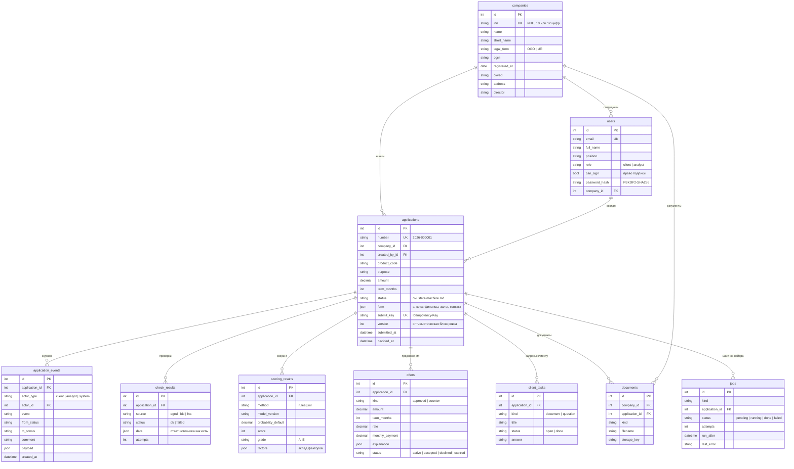

# Модель данных

Источник — `backend/app/models.py`, схема БД создаётся миграциями Alembic (`backend/migrations`).

## Зачем так

- **Заявка хранит параметры, анкета — гибкий JSON.** Параметры, по которым идут выборки и правила
  (продукт, сумма, срок, статус), — отдельные колонки. Анкета меняется чаще и хранится как JSON со схемой
  `ApplicationForm` в `app/schemas.py`.
- **Каждый этап конвейера оставляет след.** Ответы источников (`check_results`), скоринг с версией модели
  (`scoring_results`) и предложения (`offers`) хранятся отдельно — решение по заявке можно воспроизвести и
  объяснить.
- **Компания отделена от пользователя.** У одной компании несколько сотрудников с разными правами: бухгалтер
  готовит заявку, подписывает руководитель (`can_sign`).
