# Модель данных

Источник — `backend/app/models.py`, схема БД создаётся миграциями Alembic (`backend/migrations`).

```mermaid
erDiagram
    companies ||--o{ users : "сотрудники"
    companies ||--o{ applications : "заявки"
    users ||--o{ applications : "создал"
    applications ||--o{ application_events : "журнал"
    applications ||--o{ check_results : "проверки"
    applications ||--o{ scoring_results : "скоринг"
    applications ||--o{ offers : "предложения"
    applications ||--o{ client_tasks : "запросы клиенту"
    applications ||--o{ documents : "документы"
    companies ||--o{ documents : "документы"
    applications ||--o{ jobs : "шаги конвейера"
    applications ||--o| loans : "кредит"
    applications ||--o{ signing_challenges : "коды подписи"
    companies ||--o{ loans : "кредиты"
    users ||--o{ notifications : "уведомления"
    applications ||--o{ decision_explanations : "пояснения"
    application_events ||--o| decision_explanations : "к решению"

    companies {
        int id PK
        string inn UK "ИНН, 10 или 12 цифр"
        string name
        string short_name
        string legal_form "ООО | ИП"
        string ogrn
        date registered_at
        string okved
        string okved_name
        string address
        string director "руководитель по выписке ЕГРЮЛ при подключении"
    }
    users {
        int id PK
        string email UK
        string full_name
        string position
        string role "client | analyst"
        bool can_sign "право подписи"
        string password_hash "PBKDF2-SHA256"
        int company_id FK
    }
    applications {
        int id PK
        string number UK "2026-000001"
        int company_id FK
        int created_by_id FK
        string product_code
        string purpose
        decimal amount
        int term_months
        string status "см. state-machine.md"
        json form "анкета: финансы, залог, контакт, согласие на запрос в БКИ"
        json decision "итог конвейера: исход, причины, подсказки"
        string submit_key "Idempotency-Key отправки"
        int version "оптимистическая блокировка"
        datetime submitted_at
        datetime decided_at
    }
    application_events {
        int id PK
        int application_id FK
        string actor_type "client | analyst | system"
        int actor_id FK
        string event
        string from_status
        string to_status
        string comment
        json payload
        datetime created_at
    }
    check_results {
        int id PK
        int application_id FK
        string source "egrul | bki | fns"
        string status "ok | failed"
        json data "ответ источника как есть"
        string error
        int attempts
    }
    scoring_results {
        int id PK
        int application_id FK
        string method "rules | ml"
        string model_version
        decimal probability_default
        int score
        string grade "A..E"
        json factors "вклад факторов"
        json features "признаки, на которых считалась оценка"
    }
    offers {
        int id PK
        int application_id FK
        string kind "approved | counter"
        string product_code "может отличаться от продукта заявки"
        decimal amount
        int term_months
        decimal rate
        decimal monthly_payment
        json explanation
        string status "active | accepted | signed | declined | expired"
        datetime valid_until
        datetime accepted_at
        string contract_number UK "КД-2026-000001"
        datetime signed_at
        int signed_by_id FK
    }
    signing_challenges {
        int id PK
        int application_id FK
        int user_id FK
        string code_hash "HMAC кода и хеша условий договора, сам код не хранится"
        datetime expires_at
        int attempts_left
        datetime used_at
    }
    loans {
        int id PK
        int application_id FK
        int company_id FK
        string contract_number UK
        string product_code
        decimal amount
        decimal rate
        int term_months
        decimal monthly_payment
        string repayment "annuity | interest_only"
        datetime issued_at
        date first_payment_date
        string payment_ref "номер платежа в АБС"
        string status "active | closed"
    }
    notifications {
        int id PK
        int user_id FK
        string kind "status | signing_code | signature_requested | info"
        string title
        string body
        string link
        datetime read_at
    }
    client_tasks {
        int id PK
        int application_id FK
        string kind "document | field | question"
        string title
        string description
        json payload "какой документ или поле анкеты нужно; условие выдачи"
        string status "open | done | expired"
        string answer
        string created_by_type "system | analyst"
        datetime resolved_at
    }
    documents {
        int id PK
        int company_id FK
        int application_id FK
        string kind
        string filename
        string content_type
        int size_bytes
        string storage_key
        int uploaded_by_id FK
    }
    jobs {
        int id PK
        string kind
        int application_id FK
        string status "pending | running | done | failed"
        int attempts
        datetime run_after
        string last_error
    }
    decision_explanations {
        int id PK
        int application_id FK
        int decision_event_id FK "событие решения, UK"
        string status "queued | running | ready | failed | skipped"
        json facts "что ушло модели"
        string prompt_version
        string model
        string text "только прошедший проверку текст"
        string error
        string raw_response "непрошедший ответ, наружу не отдаётся"
        int latency_ms
    }
```

## Зачем так

- **Заявка хранит параметры, анкета — гибкий JSON.** Параметры, по которым идут выборки и правила
  (продукт, сумма, срок, статус), — отдельные колонки. Анкета меняется чаще и хранится как JSON со схемой
  `ApplicationForm` в `app/schemas.py`.
- **Каждый этап конвейера оставляет след.** Ответы источников (`check_results`), скоринг с версией модели
  (`scoring_results`) и предложения (`offers`) хранятся отдельно — решение по заявке можно воспроизвести и
  объяснить.
- **Пояснение решения — отдельная таблица.** `decision_explanations` заполняется, только если включено
  необязательное пояснение ([llm.md](llm.md)). Она же служит очередью генерации: фоновый поток пишет сюда и не
  трогает строку заявки, у которой оптимистическая блокировка. Пояснение привязано к событию решения, поэтому
  новое решение получает новое пояснение. Клиенту отдаётся только текст, прошедший проверку.
- **Компания отделена от пользователя.** У одной компании несколько сотрудников с разными правами: бухгалтер
  готовит заявку, подписывает руководитель (`can_sign`).
- **Часть ответов API в БД не хранится.** Лента новостей — дополнительная функция: новости лежат в
  `backend/app/data/news.json`, элемент ленты `FeedItem` существует только в ответе API (поле `application_id` — заявка,
  этап которой поднял новость). Карта одобрения (`GET /api/applications/{id}/approval-map`) считается на лету из
  сохранённого снимка `scoring_results.features` и ничего не записывает. Состояние источников и очереди
  (`/health/deps`, `/api/system/jobs`) читается из `jobs` и `application_events`; предохранитель источников живёт в
  памяти процесса.
- **Повтор проверки в журнале.** Событие `check_retry` в `payload` несёт источник и причину (`reason`); по причине
  «circuit open» история заявки пишет, что запросы к источнику приостановлены.
