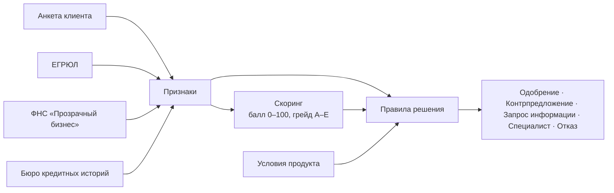

# Оценка заявки и кредитное решение

Код: `backend/app/scoring/` — `features.py` (признаки), `rules.py` (скоринг), `decision.py` (решение).

Скоринг и решение разделены, как в банковском процессе. **Скоринг** отвечает только на вопрос «насколько
рискованный заёмщик» и выдаёт грейд A–E. **Решение** учитывает продукт, сумму, срок, стоп-факторы и
долговую нагрузку — поэтому один и тот же грейд даёт разные условия для разных продуктов. На шаге с ML
скоринг по правилам заменяется моделью с тем же интерфейсом, а правила решения остаются.

## Признаки

| Признак | Откуда | Как считается |
|---|---|---|
| Срок работы бизнеса | ЕГРЮЛ | годы с даты регистрации |
| Статус компании | ЕГРЮЛ | действующая / ликвидируется |
| Выручка в месяц | ФНС, иначе анкета + выписка | годовая выручка ФНС / 12; если в налоговой данных нет — заявленная клиентом, но только при приложенной выписке |
| Рентабельность | ФНС | (выручка − расходы) / выручка |
| Платежи по действующим кредитам | БКИ | сумма ежемесячных платежей |
| Кредитная нагрузка (DSR) | расчёт | (платежи по кредитам + платёж по новому) / выручка |
| Просрочки | БКИ | максимальная за 24 месяца и текущая |
| Обращения за кредитами | БКИ | число запросов за 90 дней |
| Налоговый долг, массовый адрес, дисквалификация, блокировка счетов | ФНС | флаги |

Признаки сохраняются вместе с результатом (`scoring_results.features`) — любую оценку можно воспроизвести.

## Скоркарта (`rules-1.0`)

Базовый балл — 50, каждый фактор добавляет или снимает баллы, итог ограничен 0–100.

| Фактор | Условие | Баллы |
|---|---|---|
| Срок работы | меньше года / 1–3 года / 3–5 лет / больше 5 лет | −15 / 0 / +8 / +15 |
| Кредитная нагрузка | до 20% / до 35% / до 50% / больше 50% выручки | +15 / +5 / −10 / −25 |
| Кредитная история | нет кредитов / без просрочек / просрочки до 30, до 60, больше 60 дней | +5 / +15 / −5 / −15 / −25 |
| Текущая просрочка | есть | −20 |
| Рентабельность | больше 10% / 0–10% / убыток | +10 / +3 / −15 |
| Налоговый долг | есть | −10 |
| Обращения за 90 дней | 6 и больше / 3–5 / до 2 | −10 / −3 / +3 |
| Массовый адрес | да | −10 |

| Грейд | Балл | Ориентир вероятности дефолта | Надбавка к ставке | Доля лимита |
|---|---|---|---|---|
| A | 80–100 | 1% | 0 п.п. | 100% |
| B | 65–79 | 3% | +2 п.п. | 80% |
| C | 50–64 | 7% | +4 п.п. | 60% |
| D | 35–49 | 15% | +6 п.п. | 40% |
| E | 0–34 | 30% | — | — |

У каждого фактора есть текст для клиента и подсказка, что улучшить, — их видит клиент в решении по заявке.
Веса условные: на реальных данных их подбирает риск-подразделение, а скоркарту сменит ML-модель (шаг 5).

## Правила решения

Проверяются по порядку, срабатывает первое подходящее:

1. **Стоп-факторы → отказ.** Компания ликвидируется, руководитель дисквалифицирован, счета заблокированы,
   текущая просрочка больше 60 дней, компании меньше трёх месяцев.
2. **Выручка не подтверждена → запрос информации.** В налоговой нет данных о выручке, выписка не приложена —
   клиенту уходит запрос «Загрузите выписку», после загрузки конвейер продолжает работу сам.
3. **Грейд E → отказ** с тремя главными причинами и подсказками, что улучшить.
4. **Продукт с ручным решением или грейд C/D → специалист.** Конвейер всё равно рассчитывает условия, которые
   предложил бы, — это рекомендация для аналитика.
5. **Подбор условий.** Лимит = выручка × множитель продукта × доля по грейду (не больше максимума продукта).
   Сумма ограничивается лимитом; если все платежи по кредитам превышают 50% выручки — срок увеличивается до
   максимального, а затем сумма уменьшается шагами по 50 тыс. ₽. Если даже минимальная сумма продукта не
   проходит — отказ.
6. **Условия совпали с запрошенными → одобрение**, иначе **контрпредложение** с объяснением, что и почему
   изменилось.

| Продукт | Множитель выручки для лимита | Решение |
|---|---|---|
| Экспресс-оборот | ×1,5 | автоматическое |
| Инвестиционный кредит | ×6 | специалист |
| Овердрафт | ×0,5 | автоматическое |

## Что получается на демо-компаниях

| Компания | Заявка | Грейд | Исход |
|---|---|---|---|
| ООО «Северная пекарня» | Экспресс, 3 млн, 12 мес. | A | одобрение |
| ООО «ТехноСклад» | Экспресс, 10 млн, 12 мес. | A | контрпредложение: 4,5 млн (лимит по выручке 3 млн × 1,5) |
| ИП Смирнова | Экспресс, до 1 млн | A после выписки | запрос выписки → одобрение |
| ООО «Вектор Строй» | Инвестиционный, 25 млн, 48 мес. | C | специалист |
| ООО «Быстрый старт» | Экспресс, 2 млн | E | отказ: просрочки, текущая просрочка, убыток |
| ООО «Закат» | любая | — | отказ по стоп-фактору: ликвидация |

Эти исходы закреплены автотестами `backend/tests/test_pipeline.py`.
