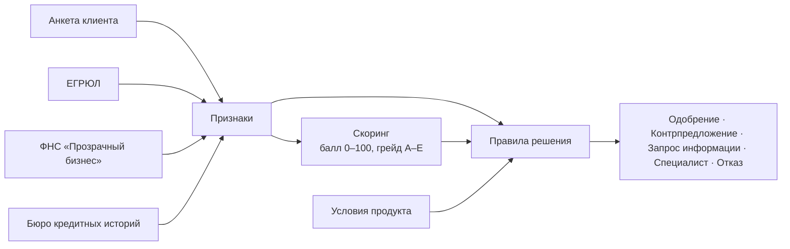

# Оценка заявки и кредитное решение

Код: `backend/app/scoring/` — `features.py` (признаки), `rules.py` (скоринг), `decision.py` (решение).

Скоринг и решение разделены, как в банковском процессе. **Скоринг** отвечает только на вопрос «насколько
рискованный заёмщик» и выдаёт грейд A–E. **Решение** учитывает продукт, сумму, срок, стоп-факторы и
долговую нагрузку — поэтому один и тот же грейд даёт разные условия для разных продуктов. На шаге с ML
скоринг по правилам заменяется моделью с тем же интерфейсом, а правила решения остаются.

## Признаки

| Признак | Откуда | Как считается |
|---|---|---|
| Срок работы бизнеса | ЕГРЮЛ | годы с даты регистрации |
| Статус компании | ЕГРЮЛ | действующая / реорганизуется / ликвидируется / банкротство / не найдена |
| Выручка в месяц | ФНС, иначе анкета + выписка | годовая выручка ФНС / 12; если в налоговой данных нет — заявленная клиентом, но только при приложенной выписке |
| Рентабельность | ФНС | (выручка − расходы) / выручка |
| Платежи по действующим кредитам | БКИ, кредиты этого банка, анкета | сумма ежемесячных платежей по БКИ плюс по кредитам, уже выданным этим банком (эмулятор БКИ о них не знает); если клиент указал в анкете больше — заявленная: анкетой нагрузку не занизить |
| Кредитная нагрузка (DSR) | расчёт | (платежи по кредитам + платёж по новому) / выручка |
| Просрочки | БКИ | максимальная за 24 месяца и текущая |
| Обращения за кредитами | БКИ | число запросов за 90 дней |
| Налоговый долг, массовый адрес, дисквалификация, блокировка счетов | ФНС | флаги |

Признаки сохраняются вместе с результатом (`scoring_results.features`) — любую оценку можно воспроизвести.

## Скоркарта (`rules-1.0`)

Базовый балл — 50, каждый фактор добавляет или снимает баллы, итог ограничен 0–100.

| Фактор | Условие | Баллы |
|---|---|---|
| Срок работы | меньше года / 1–3 года / 3–5 лет / больше 5 лет | −15 / 0 / +8 / +15 |
| Кредитная нагрузка | до 20% / до 35% / до 50% / больше 50% выручки | +15 / +5 / −10 / −25 |
| Кредитная история | нет кредитов / без просрочек / просрочки до 30, до 60, больше 60 дней | +5 / +15 / −5 / −15 / −25 |
| Текущая просрочка | есть | −20 |
| Рентабельность | больше 10% / 0–10% / убыток | +10 / +3 / −15 |
| Налоговый долг | есть | −10 |
| Обращения за 90 дней | 6 и больше / 3–5 / до 2 | −10 / −3 / +3 |
| Массовый адрес | да | −10 |

| Грейд | Балл | Ориентир вероятности дефолта | Надбавка к ставке | Доля лимита |
|---|---|---|---|---|
| A | 80–100 | 1% | 0 п.п. | 100% |
| B | 65–79 | 3% | +2 п.п. | 80% |
| C | 50–64 | 7% | +4 п.п. | 60% |
| D | 35–49 | 15% | +6 п.п. | 40% |
| E | 0–34 | 30% | — | — |

У каждого фактора есть текст для клиента и подсказка, что улучшить, — их видит клиент в решении по заявке.
Веса условные: на реальных данных их подбирает риск-подразделение, а скоркарту может сменить ML-модель (см. «Развитие» в README).

## Правила решения (`policy-1.1`)

Версия правил записывается в решение по заявке и в журнал аудита вместе с версией скоркарты.
Проверяются по порядку, срабатывает первое подходящее:

1. **Стоп-факторы → отказ.** Компания ликвидируется, в банкротстве или не найдена в ЕГРЮЛ (реорганизация —
   не стоп-фактор, а повод для специалиста), руководитель дисквалифицирован, счета заблокированы,
   текущая просрочка больше 60 дней, компании меньше трёх месяцев. Аналитик видит их как чек-лист и
   переопределить не может.
2. **Выручка не подтверждена → запрос информации.** В налоговой нет данных о выручке, выписка не приложена —
   клиенту уходит запрос «Загрузите выписку», после загрузки конвейер продолжает работу сам.
3. **Грейд E → отказ** с тремя главными причинами и подсказками, что улучшить.
4. **Поводы для специалиста** (конвейер всё равно рассчитывает условия — это рекомендация аналитику),
   в порядке проверки:
   - компания в процессе реорганизации;
   - есть текущая просрочка (до 60 дней — больше уже стоп-фактор);
   - выручка подтверждена только выпиской, а не налоговой — её сверяют с оборотами по счёту;
   - в налоговой нет данных о расходах — прибыль не посчитать;
   - продукт с ручным решением (инвестиционный кредит);
   - грейд C или D.
5. **Подбор условий.** Лимит = выручка × множитель продукта × доля по грейду (не больше максимума продукта).
   Условия проходят, если одновременно:
   - все платежи по кредитам (действующие — по БКИ и кредитам этого банка или по анкете, если там больше, +
     новый) — не больше 50 % выручки;
   - прибыль по данным ФНС (выручка − расходы) покрывает платёж по новому кредиту не меньше чем в 1,2 раза;
     прибыль ноль или меньше — условий нет вовсе.

   Для овердрафта, где ежемесячно платятся только проценты, обе проверки считаются по аннуитетному платежу на
   тот же срок — как будто лимит гасится равными долями: возврат лимита тоже должен быть посильным.
   Если в налоговой нет данных о расходах, заявку смотрит специалист. Сумма ограничивается лимитом; если
   условия не проходят — подбирается самый короткий срок, при котором они проходят, затем сумма уменьшается
   шагами по 50 тыс. ₽.
6. **Другой продукт.** Если запрошенный продукт не проходит даже на минимальную сумму, конвейер ищет другой
   продукт под ту же цель с автоматическим решением (например, овердрафт вместо «Экспресс-оборота», где
   платятся только проценты) и предлагает его контрпредложением. Если не подходит ничего — отказ.
7. **Условия совпали с запрошенными → одобрение**, иначе **контрпредложение** с объяснением, что и почему
   изменилось.

Каждое решение сохраняется вместе с трассой правил и версиями скоркарты и правил. Аналитик видит трассу в
карточке заявки и может воспроизвести решение на сохранённых признаках — результат должен совпасть.

Почему нагрузка и покрытие считаются так. Нагрузка к выручке показывает, сколько денег уходит на все кредиты;
покрытие прибылью — хватает ли заработка на новый платёж. Первое ограничивает «кредит на погашение кредита»,
второе — займы при большой выручке и низкой марже (торговля, общепит).

Ограничение, о котором важно знать: покрытие считается только для нового платежа, это упрощённый показатель,
а не полный DSCR. Прибыль по ФНС уже за вычетом процентов по действующим кредитам, но погашение их основного
долга в расчёт не входит — его сдерживает только лимит нагрузки к выручке. Принятые, но ещё не выданные
предложения по другим заявкам компании в нагрузку не входят — только выданные кредиты. В промышленной версии покрытие
считается по отчётности: денежный поток (EBITDA) к полному долговому сервису, действующему и новому, с
порогом 1,2–1,3. Пороги на реальных данных подбирает риск-подразделение.

| Продукт | Множитель выручки для лимита | Решение |
|---|---|---|
| Экспресс-оборот | ×1,5 | автоматическое |
| Инвестиционный кредит | ×6 | специалист |
| Овердрафт | ×0,5 | автоматическое |

## Что получается на демо-компаниях

| Компания | Заявка | Грейд | Исход |
|---|---|---|---|
| ООО «Северная пекарня» | Экспресс, 3 млн, 12 мес. | A | одобрение |
| ООО «ТехноСклад» | Экспресс, 10 млн, 12 мес. | A | контрпредложение: 4,5 млн (лимит по выручке 3 млн × 1,5) на 16 мес. — на 12 мес. прибыль 417 тыс. не покрывает платёж 423 тыс. с запасом; 16 мес. — самый короткий срок, при котором покрытие ≥ 1,2 |
| ИП Смирнова | Экспресс, 500 тыс., 12 мес., выручка 600 тыс. | A после выписки | запрос выписки → специалист (выручка только по выписке) → одобрение аналитиком |
| ООО «Вектор Строй» | Инвестиционный, 25 млн, 48 мес. | C | специалист; рекомендация 19,5 млн на 60 мес. (на 48 мес. покрытие 0,82) |
| ООО «Городская химчистка» | Экспресс, 300 тыс., 12 мес. | B | контрпредложение другим продуктом: овердрафт 150 тыс. — платежи по кредитам 485 тыс. при выручке 1 млн, «Экспресс» не проходит даже на минимальную сумму |
| ООО «Быстрый старт» | Экспресс, 2 млн | E | отказ: просрочки, текущая просрочка, убыток |
| ООО «Закат» | любая | C (не влияет) | отказ по стоп-фактору: ликвидация |

Эти исходы закреплены автотестами `backend/tests/test_pipeline.py`, `test_analyst.py`; правила политики на
компаниях с заданным профилем риска — `test_policy.py`.
