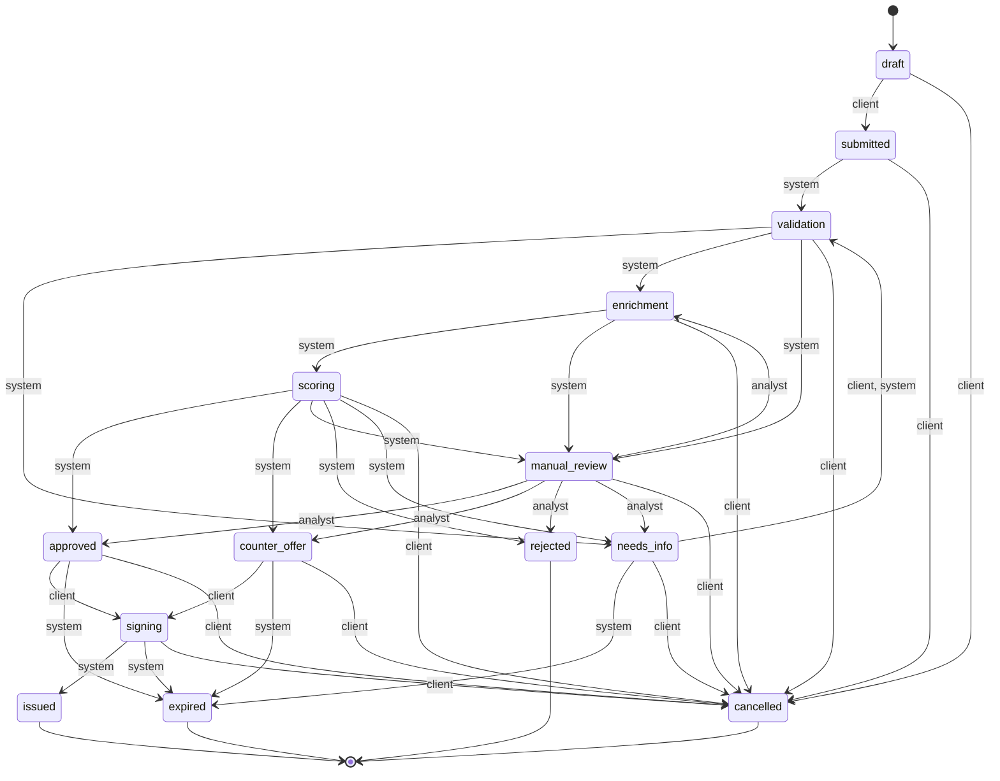

# Диаграмма состояний заявки

> Файл собран из кода: `backend/app/domain/statuses.py` — единственный источник правды о жизненном цикле заявки.
> Пересобрать диаграмму: `cd backend && python -m scripts.export_state_diagram` (CI проверяет её с `--check`). Тест `test_mermaid_diagram_lists_every_transition`
> проверяет, что каждый переход из кода попадает в диаграмму.

Любой переход, которого нет в таблице, API отклоняет с ошибкой `409 invalid_transition`. Каждый переход
записывается в журнал `application_events` (кто, когда, из какого статуса в какой, комментарий).

Переходы с актором «система» выполняет фоновый конвейер (`python -m app.worker`):
`submitted → validation → enrichment → scoring → решение`, а после подписи договора — выдачу
`signing → issued` через АБС. Если внешний источник так и не ответил, заявка из `enrichment` уходит
специалисту (`manual_review`), а не теряется; так же из `validation` и `scoring`, если шаг не удался после
всех повторов. В `expired` воркер переводит заявки с истёкшим предложением (`approved`, `counter_offer`,
неподписанный договор в `signing`) и с запросом банка без ответа 14 дней (`needs_info`).

Клиент переводит заявку из `approved`/`counter_offer` в `signing`, приняв предложение; подпись договора кодом
не меняет статус, а ставит в очередь выдачу. До подписи договора заявку можно отозвать, после подписи — нет: деньги уже в пути.
После подписи меняется только подсказка статуса: «Договор подписан. Закройте условия выдачи ниже…», если по
продукту остались открытые условия выдачи, иначе «Договор подписан. Переводим деньги…» (действие клиента не нужно).

## Статусы

| Код | Что видит клиент | Этап на таймлайне | Нужно действие клиента | Финальный | Подсказка клиенту |
|---|---|---|---|---|---|
| `draft` | Черновик | Заявка | да | — | Заявка сохранена, но ещё не отправлена. Можно вернуться и дозаполнить её в любой момент. |
| `submitted` | Заявка отправлена | Проверка данных | — | — | Мы получили заявку и уже начинаем проверку. От вас ничего не нужно. |
| `validation` | Проверяем данные | Проверка данных | — | — | Смотрим, всё ли заполнено и нет ли ошибок в анкете. От вас ничего не нужно. |
| `needs_info` | Нужна информация | Проверка данных | да | — | Нам не хватает данных. Ответьте на запрос банка ниже — после этого проверка продолжится сама. |
| `enrichment` | Проверяем компанию | Проверка компании | — | — | Сверяем данные с ЕГРЮЛ, налоговой и бюро кредитных историй. Обычно это пара минут. |
| `scoring` | Оцениваем заявку | Оценка | — | — | Рассчитываем, какие условия можем предложить. От вас ничего не нужно. |
| `manual_review` | Рассматривает специалист | Оценка | — | — | Заявку изучает кредитный специалист банка. Обычно это занимает 1–2 рабочих дня. |
| `approved` | Одобрено | Решение | да | — | Банк готов выдать кредит. Посмотрите условия и примите предложение. |
| `counter_offer` | Есть предложение | Решение | да | — | Банк готов выдать кредит на других условиях. Сравните их с запрошенными и решите, подходят ли они. |
| `rejected` | Отказ | Решение | — | да | Сейчас банк не может выдать кредит на этих условиях. Посмотрите, что можно сделать, и попробуйте другой вариант. |
| `signing` | Подписание договора | Подписание | да | — | Ознакомьтесь с договором и подпишите его кодом прямо в кабинете. |
| `issued` | Деньги зачислены | Выдача | — | да | Кредит выдан, деньги уже на расчётном счёте компании. |
| `cancelled` | Заявка отозвана | этап, на котором заявку отозвали (черновик — Заявка) | — | да | Заявка закрыта по вашему решению. Новую можно подать в любой момент. |
| `expired` | Срок истёк | Решение | — | да | Заявка закрыта: истёк срок предложения банка или срок ответа на запрос. Подайте новую заявку — данные компании подставятся автоматически. |

## Переходы

| Из | В | Кто может выполнить |
|---|---|---|
| `draft` | `submitted` | клиент |
| `submitted` | `validation` | система |
| `validation` | `needs_info` | система |
| `validation` | `enrichment` | система |
| `needs_info` | `validation` | клиент, система |
| `needs_info` | `expired` | система |
| `enrichment` | `scoring` | система |
| `enrichment` | `manual_review` | система |
| `validation` | `manual_review` | система |
| `scoring` | `approved` | система |
| `scoring` | `counter_offer` | система |
| `scoring` | `manual_review` | система |
| `scoring` | `rejected` | система |
| `scoring` | `needs_info` | система |
| `manual_review` | `approved` | аналитик |
| `manual_review` | `counter_offer` | аналитик |
| `manual_review` | `rejected` | аналитик |
| `manual_review` | `needs_info` | аналитик |
| `manual_review` | `enrichment` | аналитик |
| `approved` | `signing` | клиент |
| `approved` | `expired` | система |
| `counter_offer` | `signing` | клиент |
| `counter_offer` | `expired` | система |
| `signing` | `issued` | система |
| `signing` | `expired` | система |
| `draft` | `cancelled` | клиент |
| `submitted` | `cancelled` | клиент |
| `validation` | `cancelled` | клиент |
| `needs_info` | `cancelled` | клиент |
| `enrichment` | `cancelled` | клиент |
| `scoring` | `cancelled` | клиент |
| `manual_review` | `cancelled` | клиент |
| `approved` | `cancelled` | клиент |
| `counter_offer` | `cancelled` | клиент |
| `signing` | `cancelled` | клиент |

Клиент может отозвать заявку на любом незавершённом этапе — переходы в `cancelled` добавляются автоматически.
