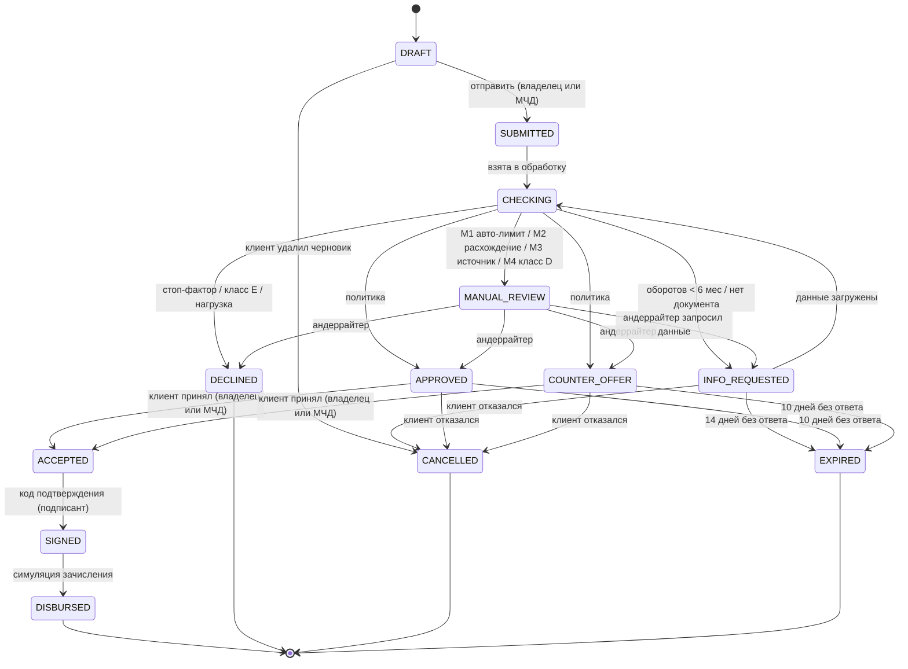

# Диаграмма состояний заявки

Сервер принимает только переходы из таблицы ниже; любой другой переход → `409 INVALID_TRANSITION`.
Конечные состояния: `DISBURSED`, `DECLINED`, `CANCELLED`, `EXPIRED`.

## Таблица переходов

| Из | В | Кто | Условие | Событие в журнале |
|---|---|---|---|---|
| DRAFT | SUBMITTED | OWNER или PREPARER с МЧД (`CREDIT_APPLICATION_SUBMIT`) | Обязательные поля, согласия ПДн и БКИ | `application_submitted` |
| DRAFT | CANCELLED | Участник компании (кроме VIEWER) | — | `cancelled` |
| SUBMITTED | CHECKING | Система | Воркер взял заявку | `checking_started` |
| CHECKING | INFO_REQUESTED | Система | Оборотов < 6 мес или нет обязательного документа | `info_requested` |
| CHECKING | MANUAL_REVIEW | Система | M1–M4 | `manual_review_started` |
| CHECKING | APPROVED / COUNTER_OFFER / DECLINED | Система | Политика решения | `decision_*` |
| INFO_REQUESTED | CHECKING | Участник компании (кроме VIEWER) | Данные загружены | `info_uploaded` |
| INFO_REQUESTED | CANCELLED / EXPIRED | Клиент / система | Отказ / 14 дней | `cancelled` / `expired` |
| MANUAL_REVIEW | APPROVED / COUNTER_OFFER / DECLINED | UNDERWRITER | В пределах `approval_limit` | `decision_*`, `underwriter_comment` |
| MANUAL_REVIEW | INFO_REQUESTED | UNDERWRITER | Нужны данные | `info_requested` |
| APPROVED / COUNTER_OFFER | ACCEPTED | OWNER или PREPARER с МЧД | Оффер не истёк | `offer_accepted` |
| APPROVED / COUNTER_OFFER | CANCELLED / EXPIRED | Клиент / система | Отказ / 10 дней | `offer_declined` / `expired` |
| ACCEPTED | SIGNED | OWNER или PREPARER с МЧД (`CREDIT_AGREEMENT_SIGN`) | Верный код | `signed` |
| SIGNED | DISBURSED | Система | Симуляция зачисления | `disbursed` |

Каждый переход пишется в append-only журнал `Event` (кто, когда, из какого статуса, в какой) в одной
транзакции со сменой статуса; уведомления и лента читают журнал через outbox.
